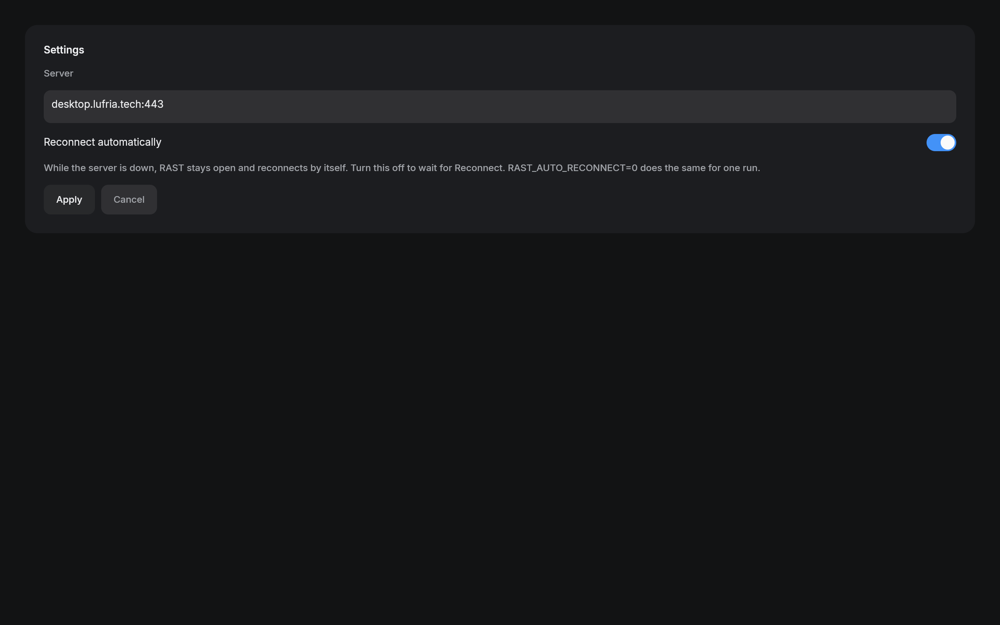

# RAST

A self-hosted **Linux web desktop**: every RAST user is a real Linux account with
one HOME, installed Linux apps open as desktop windows, and the whole desktop is
driven from the browser.

## Status: clean rewrite on Rune (2026-11-21)

The previous implementation (0.18.x → 1.0.1 remake) was **removed on
2026-11-21** and RAST is being rebuilt from scratch on
[Rune](https://github.com/anomalyco/rune), a GPU-rendered Rust UI framework.

- The old tree is still reachable from branch `Remake` and tag
  `archive/pre-rune-rewrite-2026-11-21`. Production keeps running the last
  released build (`1.0.1-alpha.2`) until the rewrite ships; **this branch is not
  deployable yet** — see [docs/DEPLOYMENT.md](docs/DEPLOYMENT.md).
- Work happens on `revamp/remake`.
- What exists today: a **cross-platform client shell** (Linux, Windows, macOS,
  plus a WebGPU browser build) that knows its RAST server and survives the
  server going down. The desktop, apps and the server are the next phases.


## What the client does

- Native window on Linux, Windows and macOS; wasm build for the browser.
- Connects to the configured RAST server and shows *Connecting*, *Connected*,
  *Server unreachable* or *Set up the server*.
- **Survives server downtime**: it keeps running, retries on a backoff
  (1 s → 2 s → 4 s → 8 s → 15 s → 30 s) and turns back into the connected state
  by itself when the server answers again. While connected it re-checks every
  10 s, so a server that goes away is noticed too.
- **Settings screen** to change the server and to turn automatic reconnection
  *off* (optional, persisted). Off means: stay offline until *Reconnect now*.
  `RAST_AUTO_RECONNECT=0` does the same for a single run.
- Configuration is a small text file per OS — see [docs/CLIENT.md](docs/CLIENT.md)
  for paths, format and overrides.



## Build and run

Rust **1.99.1** is pinned in `rust-toolchain.toml` (the toolchain Rune uses).

Linux build/runtime dependencies (Rune's windowing stack):

```sh
sudo apt-get install -y libxkbcommon-dev libwayland-dev libxkbcommon-x11-0 mesa-vulkan-drivers
```

```sh
cargo run -p rast-ui --bin rast       # open the native window
cargo test -p rast-ui                 # headless tests: no GPU, no display
```

Headless renders (what CI proves; `--scene` can be `offline`, `online`,
`settings` or `setup`):

```sh
VK_ICD_FILENAMES=/usr/share/vulkan/icd.d/lvp_icd.json \
  cargo run -q -p rast-ui --bin rast -- --snap target/rast.png --scene offline
```

On a machine with a real GPU, drop the `VK_ICD_FILENAMES` variable.

Browser build (experimental; needs WebGPU):

```sh
rustup target add wasm32-unknown-unknown
cargo install wasm-bindgen-cli --version 0.2.129 --locked
scripts/web-build.sh
python3 -m http.server 8000 -d dist/web
```

### Windows and macOS

The code is platform-neutral (settings paths, networking and UI are the same
everywhere). CI builds and tests on `ubuntu-24.04`, `windows-latest` and
`macos-latest`, and packages release binaries for Linux and Windows on
`workflow_dispatch`/tags. macOS packaging (signed `.app`) is not set up yet;
shipping a macOS binary to other machines needs code signing/notarisation.

## Updating Rune

Rune is pre-release and publishes no releases, tags or crates.io package, so
"a new patch" means a new commit on Rune's `dev` branch, and updating means
moving the pinned revision.

- Ask whether a newer revision exists: `scripts/check-rune-pin.sh` (exit `10`
  means yes). CI runs it weekly.
- Update in a review branch: `scripts/update-rune.sh` (add `--dry-run` to only
  preview the manifest change) — it regenerates the vendored-crate patch table,
  refreshes `Cargo.lock`, builds, tests, renders a snapshot and prints the Rune
  commits between the two revisions.

The full procedure, gotchas and rollback are in
[docs/UPDATING-RUNE.md](docs/UPDATING-RUNE.md).

## Repository layout

| Path | What it is |
| --- | --- |
| `crates/rast-ui/src/lib.rs` | Client shell: app wiring, state, screens routing, headless tests |
| `crates/rast-ui/src/connection.rs` | Server address parsing, retry policy, background prober |
| `crates/rast-ui/src/config.rs` | Settings file, platform paths, `RAST_AUTO_RECONNECT` |
| `crates/rast-ui/src/ui.rs` | The desktop status card and the settings screen |
| `scripts/web-build.sh` | Static WASM + WebGPU build |
| `scripts/check-rune-pin.sh` | Compares the pinned Rune revision with Rune's `dev` |
| `scripts/update-rune.sh` | Bumps the pin and the matched `[patch.crates-io]` table |
| `docs/CLIENT.md` | Client behaviour, settings, build and platform notes |
| `docs/DEPLOYMENT.md` | Deployment state and the safe staging-first plan |
| `docs/UPDATING-RUNE.md` | How Rune updates work, gates, rollback |

## Quality gates

Every change must pass, and CI runs them:

```sh
cargo fmt --all -- --check
cargo clippy --locked --workspace --all-targets -- -D warnings
cargo test --locked --workspace
```

Plus headless renders for UI changes, `scripts/web-build.sh` for the wasm
target, and the cross-platform build/test matrix.
