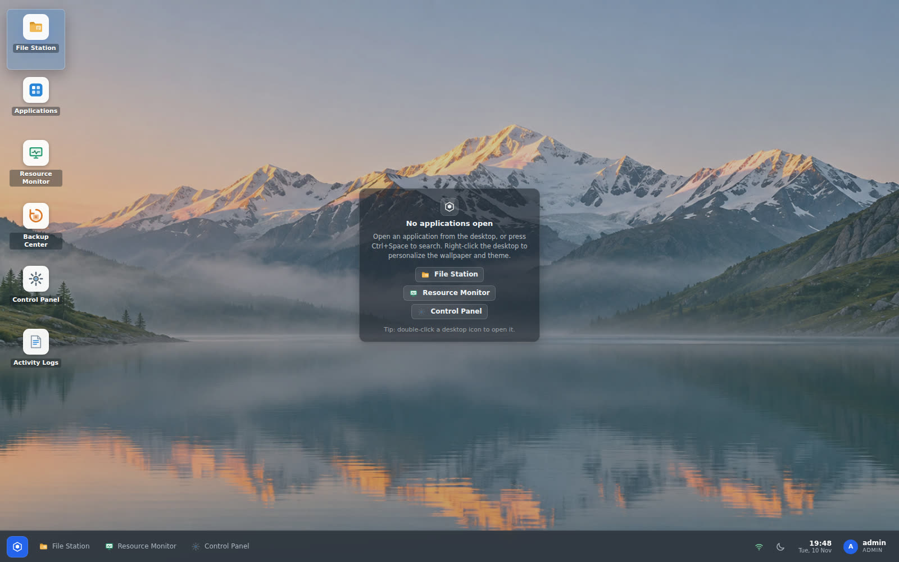
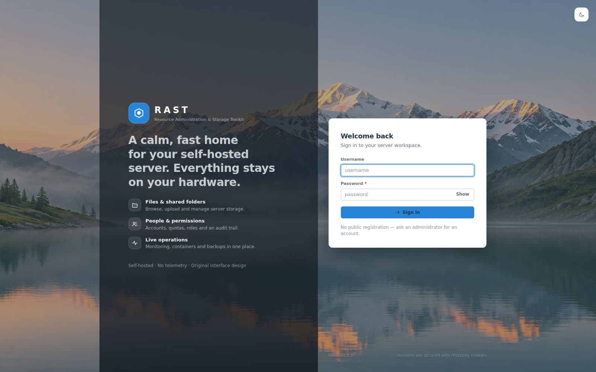
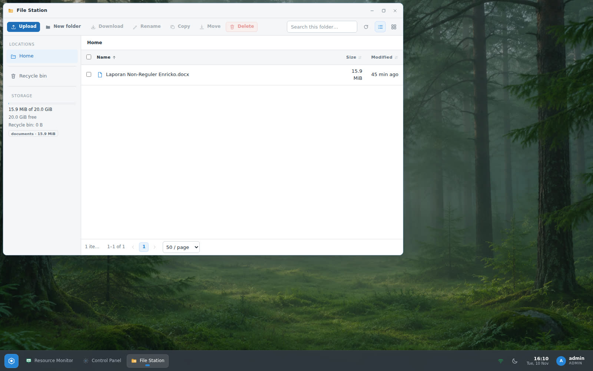
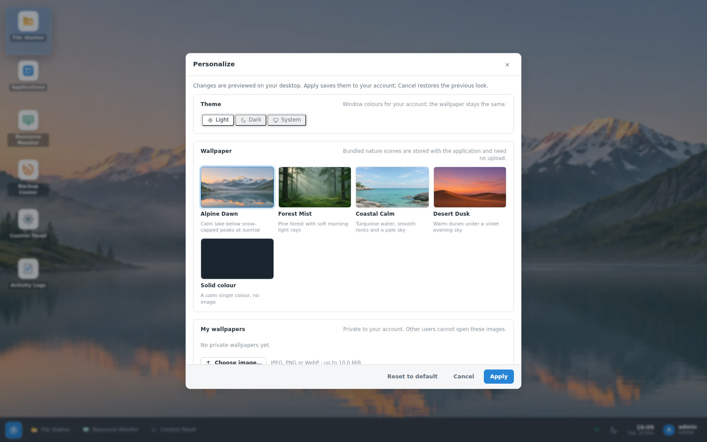
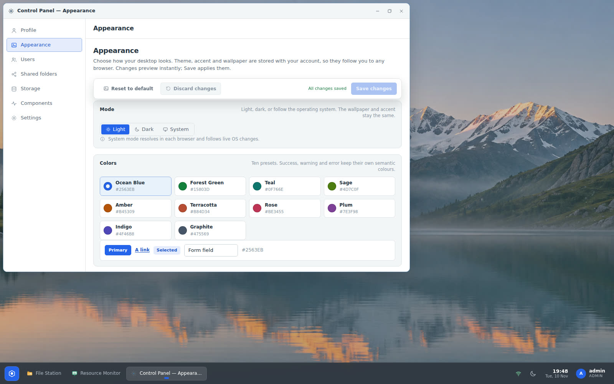
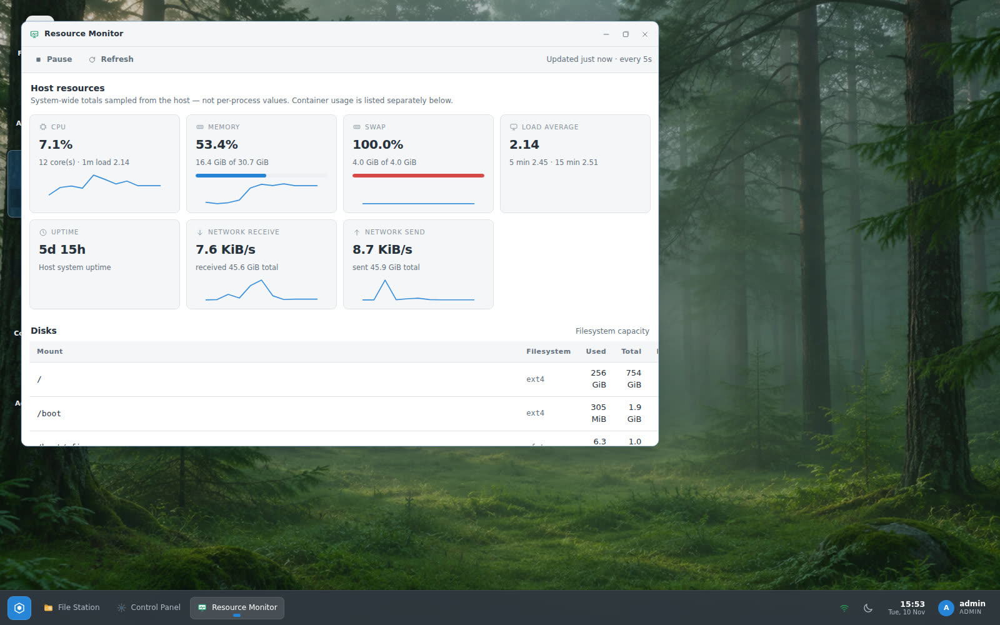
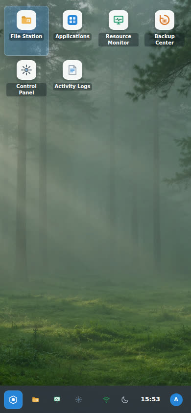
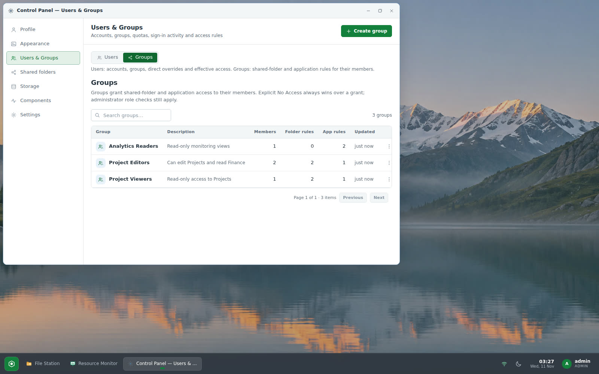
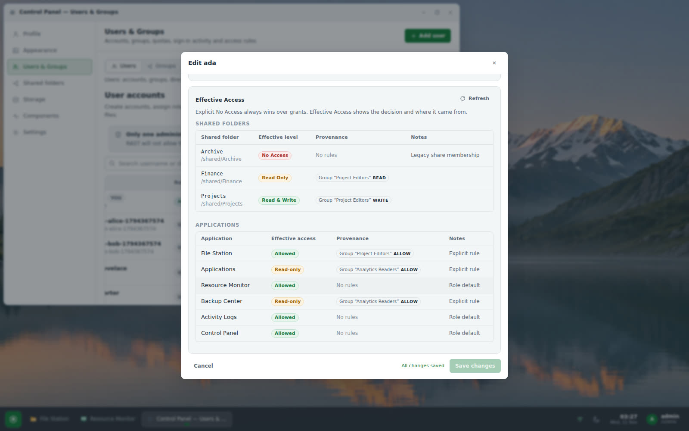

# RAST

**Resource Administration & Storage Toolkit** — a self-hosted server
administration toolkit with a desktop-like web UI, distributed as a single Rust
binary.

RAST bundles the day-to-day server admin tools into one web desktop:

| App | What it does |
| --- | --- |
| **File Station** | Browse, upload, download, rename, copy, move, delete, preview and restore files, with per-user homes, shared folders and quotas. |
| **Applications** | Deploy and manage Docker Compose applications through a restricted administrative worker. |
| **Resource Monitor** | Live CPU, memory, swap, disk, network and container metrics. |
| **Control Panel** | Profile, password, users, roles, quotas, shared folders, storage locations, appearance and component health. |
| **Appearance** | Per-user wallpaper (bundled nature scenes, solid colour or private upload), fit/position/overlay, light/dark/system mode and ten accent presets, saved on the server. |
| **Live updates** | One authenticated event stream per tab keeps files, applications, containers, backups, audit logs, control panel data and appearance synchronized automatically — including changes made outside RAST and in other sessions. |
| **Users & Groups** | NAS-style groups with shared-folder and application rules, multi-group membership, per-user direct overrides with an Effective Access explanation, live reauthorization and audit trail. Group grants never elevate the administrator role. |
| **Backup Center** | Consistent SQLite + configuration backups with schedules, retention and restore guidance. |
| **Activity Logs** | Auditable record of every action: who, what, when, result. |

[](https://github.com/Enricko/rast/actions/workflows/ci.yml)
[](https://github.com/Enricko/rast/releases)
[](LICENSE)


> **Status:** v0.2.0 — first public release series (2026-11-11). APIs and data
> formats may still change before v1.0; see [CHANGELOG.md](CHANGELOG.md) for the
> exact feature set and known limitations.

## Screenshots



| | |
| --- | --- |
|  |  |
|  |  |
|  |  |
|  |  |

## Verified deployment

RAST 0.2.0 is deployed and publicly reachable at
<https://desktop.lufria.tech> behind Cloudflare Tunnel + nginx. Measured on the
reference host (Ubuntu, x86_64, 12 cores / 30 GiB RAM) after a clean restart,
60-second idle window:

| Process | CPU (idle) | RSS |
| --- | --- | --- |
| `rast.service` (web + jobs + monitor + realtime + access policy + SQLite) | 0.13% | 11.4 MiB |
| `rast-worker.service` (Docker operations) | 0.03% | 9.9 MiB |
| **Total RAST** | **0.13%** | **21.4 MiB** |

Well below the project budget of 100 MiB idle RAM. The Users & Groups feature
adds one evaluator with an in-process decision cache (invalidated after policy
changes) and no per-request polling. After long activity, allocator retention
can read somewhat higher (≈30–65 MiB) without a leak.

Verification on the live deployment: **85/85 end-to-end smoke checks**
(auth/CSRF, two-user isolation, files/quota/trash, monitoring, SSE, backups,
logs, Docker worker, appearance, accents and the new group policy: grant,
read-only denial, effective-access provenance, live revocation and group-delete
retention), **306 automated Rust tests** (284 unit/integration + 22 HTTP
end-to-end), a **64/64 clean-systemd-container installer suite** for the v0.2.0
tree, an independent migration check from a real v0.1.8 legacy-ACL database
(schema v4 applied, users/appearance/share rows byte-identical, effective access
still `write` through the legacy fallback), and **44/44 live Playwright checks**
for the Users & Groups workflow (create/edit/delete groups,
members and rules, single-save, user group membership + effective access with
provenance and deny conflicts, launcher permissions, read-only Applications,
live membership revocation in an already signed-in File Station, fictional
accounts/files only). CI is green on `main` and the v0.2.0 release run is green;
the production database was backed up before applying the additive schema-v4
migration (`0004_groups`) and the previous appearance/user rows were verified
intact. See [docs/user-groups-handoff.md](docs/user-groups-handoff.md) for the
full feature handoff.

## Quick start (installed server)

```bash
# 1. Install (Linux x86_64 / arm64, systemd)
curl -fsSL https://github.com/Enricko/rast/releases/latest/download/install.sh | sudo sh

# 2. Create the first administrator (CLI only — there is no default password)
sudo -u rast rast user create-admin admin --password-stdin

# 3. Open the web UI at https://your-host/ and sign in
```

The installer creates the `rast` service account, `/etc/rast/`, `/var/lib/rast/`
and `/srv/rast/`, installs a `rast.service` systemd unit and starts it bound to
`127.0.0.1:8720`. Put it behind your reverse proxy with TLS.

## Build from source

Requirements: Rust stable (pinned in `rust-toolchain.toml`), Node.js 22+ and
npm **for the frontend build only**. The installed server never needs Node.js.

```bash
git clone https://github.com/Enricko/rast.git
cd rast
npm --prefix frontend ci
npm --prefix frontend run build
cargo build --release
./target/release/rast version
```

## Configuration

See [docs/CONFIGURATION.md](docs/CONFIGURATION.md). Defaults:

| Item | Path |
| --- | --- |
| Configuration | `/etc/rast/rast.toml` |
| Database & backups | `/var/lib/rast/` |
| User files | `/srv/rast/` |
| Binary | `/usr/local/bin/rast` |
| Service | `rast.service` (worker: `rast-worker.service`) |

Environment variables use the `RAST_` prefix (see `.env.example`).

## Security model

* Argon2id password hashing (19 MiB, 2 iterations, 1 lane).
* Server-side sessions stored as SHA-256 hashes; `HttpOnly`, `Secure`,
  `SameSite=Lax` cookies; CSRF tokens required for every mutating request.
* Login rate limiting and per-account lockout; no public registration; the
  first administrator can only be created from the CLI or with a one-shot
  setup token.
* Per-user filesystem isolation with path-traversal and symlink-escape
  protection enforced on the server for every endpoint.
* Per-user appearance is private: uploaded wallpapers are validated, stored
  under server-generated identifiers and served only to their owner.
* Realtime events are authorized server-side per account/role; sessions are
  revalidated while streaming and credentials never appear in event URLs.
* Docker operations run through a separate worker process with a strict
  message protocol — the web server never talks to the Docker socket.

See [SECURITY.md](SECURITY.md) for reporting vulnerabilities.

## Documentation

* [Architecture](docs/ARCHITECTURE.md)
* [Configuration](docs/CONFIGURATION.md)
* [Installation](docs/INSTALL.md)
* [Operations: backup, restore, update, rollback](docs/OPERATIONS.md)
* [API reference](docs/API.md)
* [Wallpapers and their licence](docs/WALLPAPERS.md)
* [Realtime synchronization contract](docs/REALTIME.md)
* [Users & Groups handoff](docs/user-groups-handoff.md)

## License

MIT — see [LICENSE](LICENSE). Dependency licenses are listed in
[docs/THIRD-PARTY-LICENSES.md](docs/THIRD-PARTY-LICENSES.md) (generated with
`cargo license`).
