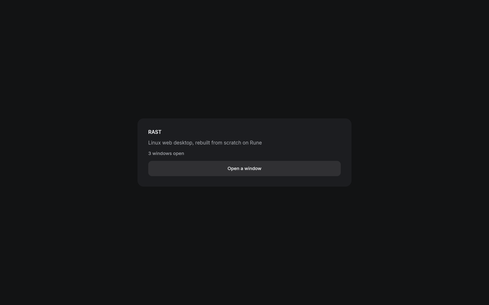

# RAST

A self-hosted **Linux web desktop**: every RAST user is a real Linux account with
one HOME, installed Linux apps open as desktop windows, and the whole desktop is
driven from the browser.

## Status: clean rewrite on Rune (2026-11-21)

The previous implementation (0.18.x → 1.0.1 remake) was **removed on
2026-11-21** and RAST is being rebuilt from scratch on
[Rune](https://github.com/anomalyco/rune), a GPU-rendered Rust UI framework.

- The old tree is still reachable from branch `Remake` and tag
  `archive/pre-rune-rewrite-2026-11-21`. Production keeps running the last
  released build (`1.0.1-alpha.2`) until the rewrite ships; this branch is not
  deployable yet.
- `crates/rast-ui` is the first slice: one Rune window with the RAST identity and
  a headless-tested interactive element. The server, the users' Linux sessions,
  the app launcher and File Station are built around it, one reviewed step at a
  time.

Nothing in this repository is stable: paths, APIs and the file layout will move
while the rewrite is young.



## Stack

| Layer | Choice |
| --- | --- |
| Language | Rust 1.99.1 (the toolchain Rune pins) |
| UI | [Rune](https://github.com/anomalyco/rune) — native GPU-rendered (wgpu + winit), with an experimental WASM + WebGPU target for the browser |
| Rune delivery | Git dependency pinned to one `dev` revision (no releases or tags exist) — see [Updating Rune](#updating-rune) |
| Licence | MIT |

## Build and run

Linux build dependencies (needed by Rune's windowing stack):

```sh
sudo apt-get install -y libxkbcommon-dev libwayland-dev libxkbcommon-x11-0 mesa-vulkan-drivers
```

Native window:

```sh
cargo run -p rast-ui --bin rast
```

Headless checks (no display; they render through Rune's own runtime, so they are
the quality gate for layout and input):

```sh
cargo test -p rast-ui                      # layout + hit-testing + state, no GPU
VK_ICD_FILENAMES=/usr/share/vulkan/icd.d/lvp_icd.json \
  cargo run -q -p rast-ui --bin rast -- --snap target/rast.png --scene opened
```

The second command uses the software Vulkan driver (lavapipe) on a machine
without a GPU; drop the env var where a real GPU is available.

Browser build (experimental; needs WebGPU):

```sh
rustup target add wasm32-unknown-unknown
cargo install wasm-bindgen-cli --version 0.2.129 --locked
scripts/web-build.sh
python3 -m http.server 8000 -d dist/web
```

## Updating Rune

Rune is pre-release and publishes no releases, tags or crates.io package, so
"a new patch" means a new commit on Rune's `dev` branch, and updating means
moving the pinned revision.

- Ask whether a newer revision exists: `scripts/check-rune-pin.sh` (exit `10`
  means yes). CI runs it weekly.
- Update in a review branch: `scripts/update-rune.sh` — it regenerates the
  vendored-crate patch table, refreshes `Cargo.lock`, builds, tests, renders a
  snapshot and prints the Rune commits between the two revisions.

The full procedure, gotchas and rollback are in
[docs/UPDATING-RUNE.md](docs/UPDATING-RUNE.md).

## Repository layout

| Path | What it is |
| --- | --- |
| `crates/rast-ui/` | The desktop shell: Rune views, shell state, native `rast` binary, wasm entrypoint, `index.html` |
| `scripts/web-build.sh` | Static WASM + WebGPU build of the shell |
| `scripts/check-rune-pin.sh` | Compares the pinned Rune revision with Rune's `dev` |
| `scripts/update-rune.sh` | Bumps the pin and the matched `[patch.crates-io]` table |
| `docs/UPDATING-RUNE.md` | How Rune updates work, gates, rollback |

## Quality gates

Every change must pass, and CI runs them:

```sh
cargo fmt --all -- --check
cargo clippy --locked --workspace --all-targets -- -D warnings
cargo test --locked --workspace
```

Plus the headless snapshot above for UI changes, and `scripts/web-build.sh` when
the wasm target is touched.
