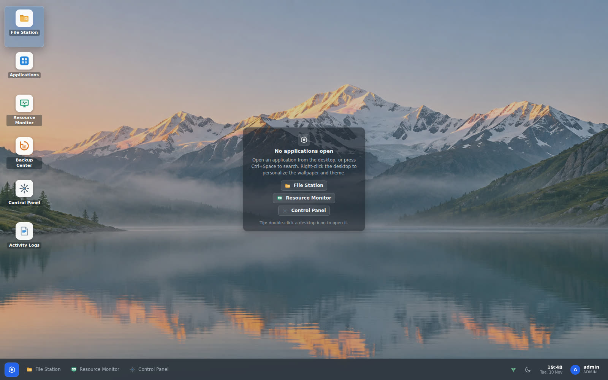
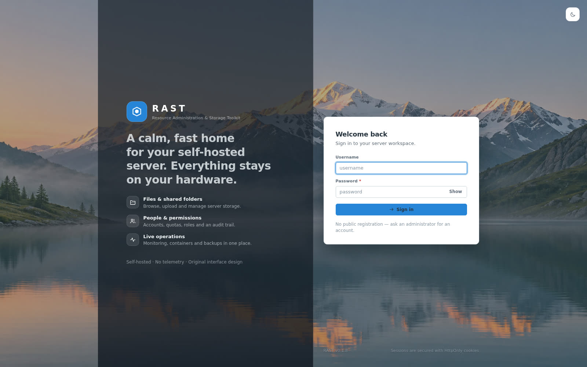
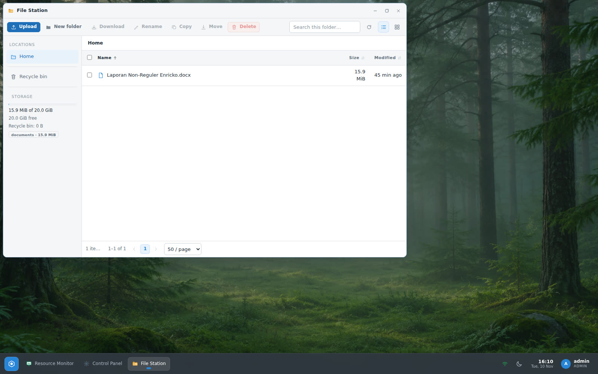
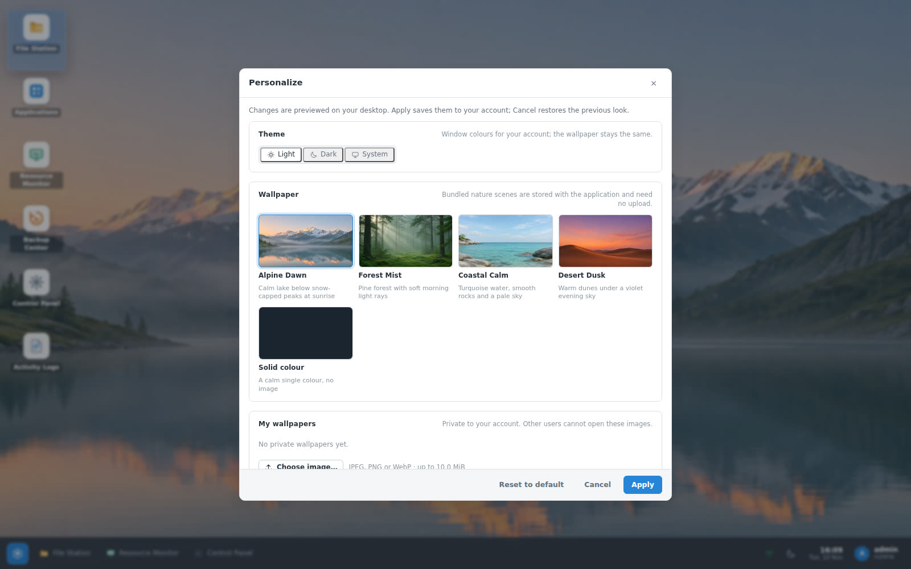
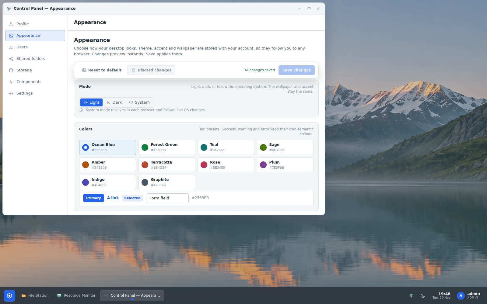
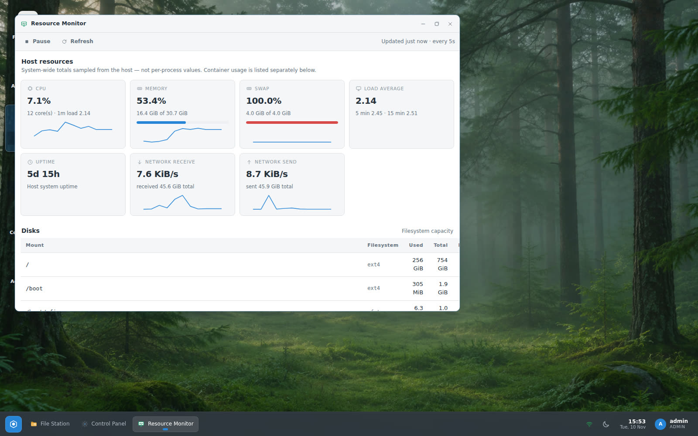
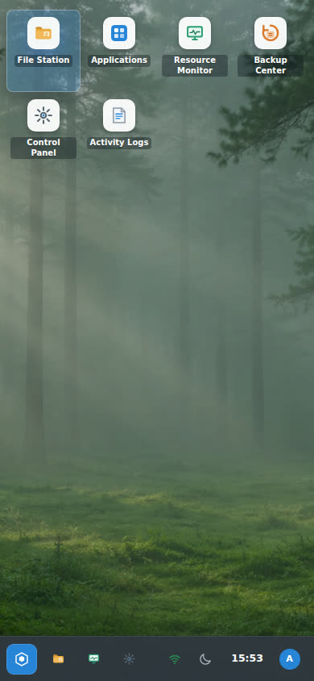
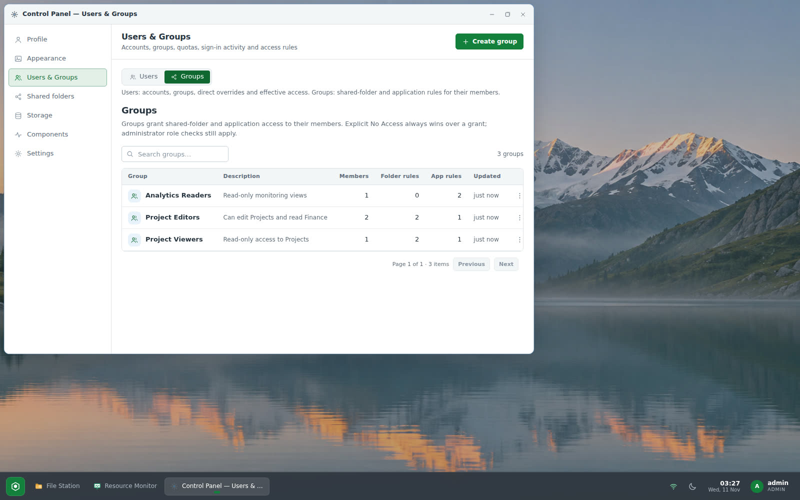
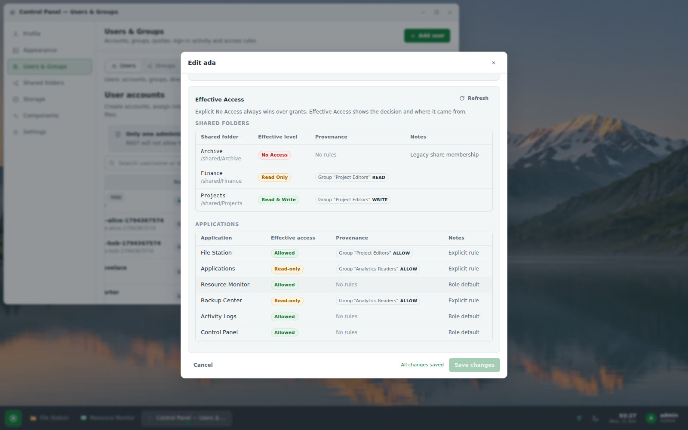

# RAST

**Resource Administration & Storage Toolkit** — a self-hosted server
administration toolkit with a desktop-like web UI, distributed as a single Rust
binary.

RAST bundles the day-to-day server admin tools into one web desktop:

| App | What it does |
| --- | --- |
| **File Station** | Browse, upload, download, rename, copy, move, delete, preview and restore files, with per-user homes, shared folders and quotas. |
| **Applications** | One folder with every app the account may open; drag apps to the desktop or taskbar. Desktop icons can be moved and removed, per account. |
| **Docker** | Deploy and manage Docker Compose applications through a restricted administrative worker. Optional: can be uninstalled in App Center. |
| **Resource Monitor** | Live CPU, memory, swap, disk, network and container metrics. |
| **Control Panel** | Profile, password, users, roles, quotas, shared folders, storage locations, appearance and component health. |
| **Appearance** | Per-user wallpaper (bundled nature scenes, solid colour or private upload), fit/position/overlay, light/dark/system mode and ten accent presets, saved on the server. |
| **Live updates** | One authenticated event stream per tab keeps files, applications, containers, backups, audit logs, control panel data and appearance synchronized automatically — including changes made outside RAST and in other sessions. |
| **Users & Groups** | NAS-style groups with shared-folder and application rules, multi-group membership, per-user direct overrides with an Effective Access explanation, live reauthorization and audit trail. Group grants never elevate the administrator role. |
| **Backup Center** | Consistent SQLite + configuration backups with schedules, retention and restore guidance. Optional: can be uninstalled in App Center. |
| **App Center** | RAST's own apps (install or uninstall the optional ones) and verified Python, PHP CLI, Go, Node.js, Rust, Eclipse Temurin JDK, Bun, Deno, .NET SDK (C#), Clang/LLVM (C/C++), Flutter (with Dart), Composer, Zig, Kotlin, CMake, Gradle and Apache Maven runtimes from a signed catalog, side by side with a selectable default, updates with rollback, official runtime/app icons, and packages imported from GitHub releases (icons can be embedded by package authors; see [PACKAGE-ICONS.md](docs/PACKAGE-ICONS.md) and the [handoff](docs/package-center-handoff.md)). |
| **Linux apps** | Install desktop Linux applications with the administrator-only **App Center → Install Linux App** workflow: upload a `.deb` or portable archive, or use the vendor's official HTTPS link; review the detected app, compatibility, package changes, saved profiles and who can use it; then follow Uploading → Validating → Installing → Registering → Ready (the job keeps running when App Center is closed). Existing host packages are registered honestly instead of reinstalled, and per-user profiles are preserved across uninstall/reinstall. Each person gets one unprivileged Linux identity and one lazily started Xpra seamless session shared by all their apps, with every normal window managed by the RAST desktop (dialogs/popups are attached transients). Legacy Docker-backed apps can be migrated in place. See [docs/NATIVE-LINUX-APPS.md](docs/NATIVE-LINUX-APPS.md) and [docs/INSTALL.md](docs/INSTALL.md#native-linux-apps-xpra). |
| **Terminal** | First-class terminal app with real PTY shells: multiple tabs/windows, bash (sh fallback), full-screen TUI support, copy/paste/search/scrollback/font-size, reconnect after network drops, and a runtime environment panel (Python, PHP, Go, Node.js, Rust, Java, Bun, Deno, .NET/C#, Clang/LLVM C/C++, Flutter/Dart, Composer, Zig, Kotlin, CMake, Gradle, Maven) with per-user defaults and per-tab overrides. Administrators get a root shell by default (`terminal_admin_root`), while ordinary accounts must be granted access and always run as a mapped unprivileged `rast-u<id>` identity — no Docker, Xpra or graphical session — and File Station's **Open in Terminal** maps RAST folder permissions to OS ACLs. See [docs/TERMINAL.md](docs/TERMINAL.md). |
| **Linux apps** | Install desktop Linux applications
| **Activity Logs** | Auditable record of every action: who, what, when, result. |

[](https://github.com/Enricko/rast/actions/workflows/ci.yml)
[](https://github.com/Enricko/rast/releases)
[](LICENSE)


> **Status:** v0.13.3 — native Linux apps and the Install Linux App workflow are restored on top of the newer `main` line (desktop/File Station multi-selection, package app-type support), with per-window desktop integration and playback-only session audio (2026-11-14). APIs and data formats may still
> change before v1.0; see [CHANGELOG.md](CHANGELOG.md) for upgrade requirements
> and known limitations.

## Screenshots



| | |
| --- | --- |
|  |  |
|  |  |
|  |  |
|  |  |

## Verified deployment

RAST is deployed at <https://desktop.lufria.tech> behind Cloudflare Tunnel +
nginx. The measurements below are historical **0.3.0 core-service** results,
not a performance claim for native Chrome/Xpra/audio sessions. They were
measured on the reference host (Ubuntu, x86_64, 12 cores / 30 GiB RAM) after a
clean restart and a 60-second idle window:

| Process | CPU (idle) | RSS |
| --- | --- | --- |
| `rast.service` (web + jobs + monitor + realtime + access policy + SQLite) | 0.22% | 10.7 MiB |
| `rast-worker.service` (Docker operations) | 0.03% | 7.6 MiB |
| **Total RAST** | **0.25%** | **18.3 MiB** |

Well below the project budget of 100 MiB idle RAM. An equivalent-conditions
comparison against v0.2.0 (same data, idle + 3 SSE clients + 400 API requests,
alternating rounds) showed no measurable difference.

Verification of the 0.3.0 security audit and hardening release: **91/91
production smoke checks** through the reverse proxy (including read-only
Applications/Backup boundaries), **297 + 27 automated Rust tests** (unit/
integration + HTTP end-to-end, including an Effective-Access-versus-API
cross-check), **38/38 live browser checks** with fictional accounts, an
isolated v0.2.0 → v0.3.0 upgrade with 0 differences in effective access and
appearance, rollback/restore drills, Sigstore build-provenance attestations
verified in CI and independently, native runtime smoke on x86_64 and arm64,
and a **65/65 clean-systemd-container installer suite** with in-container
attestation verification. See
[docs/audit-hardening-handoff.md](docs/audit-hardening-handoff.md).

## Quick start (installed server)

```bash
# 1. Install (Linux x86_64 / arm64, systemd)
curl -fsSL https://github.com/Enricko/rast/releases/latest/download/install.sh | sudo sh

# 2. Create the first administrator (CLI only — there is no default password)
sudo -u rast rast user create-admin admin --password-stdin

# 3. Open the web UI at https://your-host/ and sign in
```

The installer creates the `rast` service account, `/etc/rast/`, `/var/lib/rast/`
and `/srv/rast/`, installs a `rast.service` systemd unit and starts it bound to
`127.0.0.1:8720`. Put it behind your reverse proxy with TLS.

## Build from source

Requirements: Rust stable (pinned in `rust-toolchain.toml`), Node.js 22+ and
npm **for the frontend build only**. The installed server never needs Node.js.

```bash
git clone https://github.com/Enricko/rast.git
cd rast
npm --prefix frontend ci
npm --prefix frontend run build
cargo build --release
./target/release/rast version
```

## Configuration

See [docs/CONFIGURATION.md](docs/CONFIGURATION.md). Defaults:

| Item | Path |
| --- | --- |
| Configuration | `/etc/rast/rast.toml` |
| Database & backups | `/var/lib/rast/` |
| User files | `/srv/rast/` |
| Binary | `/usr/local/bin/rast` |
| Service | `rast.service` (worker: `rast-worker.service`) |

Environment variables use the `RAST_` prefix (see `.env.example`).

## Security model

* Argon2id password hashing (19 MiB, 2 iterations, 1 lane).
* Server-side sessions stored as SHA-256 hashes; `HttpOnly`, `Secure`,
  `SameSite=Lax` cookies; CSRF tokens required for every mutating request.
* Login rate limiting and per-account lockout; no public registration; the
  first administrator can only be created from the CLI or with a one-shot
  setup token.
* Per-user filesystem isolation with path-traversal and symlink-escape
  protection enforced on the server for every endpoint.
* Per-user appearance is private: uploaded wallpapers are validated, stored
  under server-generated identifiers and served only to their owner.
* Realtime events are authorized server-side per account/role; sessions are
  revalidated while streaming and credentials never appear in event URLs.
* Docker operations run through a separate worker process with a strict
  message protocol — the web server never talks to the Docker socket.
* Native Linux apps run under per-user unprivileged Linux identities in
  systemd cgroups; a small root helper is the only privileged component and
  performs a strict, validated operation whitelist (systemd units, admin-
  approved APT transactions, managed paths). The session proxy authenticates
  every request (another user's session is `403`) and live display streams
  revalidate the RAST login session every 5 s, so logout or revocation closes
  the display immediately. A root-installed nftables rule restricts the
  loopback Xpra display ports to the RAST service account; the `nftables`
  package is required and `rast doctor` reports it. Applications of one
  account share that account's trust boundary and are not isolated from each
  other; shared folders are not mapped into native app profiles, and the
  person's RAST home is exposed read-only. See
  [docs/NATIVE-LINUX-APPS.md](docs/NATIVE-LINUX-APPS.md). Xpra 6.5+ is invoked
  as an external program (GPL-2.0-or-later server, MPL-2.0 HTML5 client) and
  is not linked into or distributed with RAST — install it from
  <https://xpra.org>. Chromium keeps its sandbox (`--no-sandbox` is never
  used).

See [SECURITY.md](SECURITY.md) for reporting vulnerabilities.

## Documentation

* [Architecture](docs/ARCHITECTURE.md)
* [Configuration](docs/CONFIGURATION.md)
* [Installation](docs/INSTALL.md)
* [Native Linux apps](docs/NATIVE-LINUX-APPS.md)
* [Operations: backup, restore, update, rollback](docs/OPERATIONS.md)
* [API reference](docs/API.md)
* [Wallpapers and their licence](docs/WALLPAPERS.md)
* [Realtime synchronization contract](docs/REALTIME.md)
* [Users & Groups handoff](docs/user-groups-handoff.md)
* [Audit & hardening handoff (0.3.0)](docs/audit-hardening-handoff.md)

## License

MIT — see [LICENSE](LICENSE). Dependency licenses are listed in
[docs/THIRD-PARTY-LICENSES.md](docs/THIRD-PARTY-LICENSES.md) (generated with
`cargo license`).
