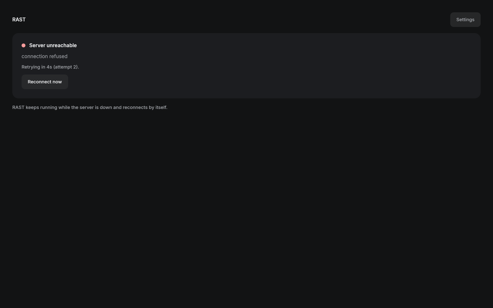
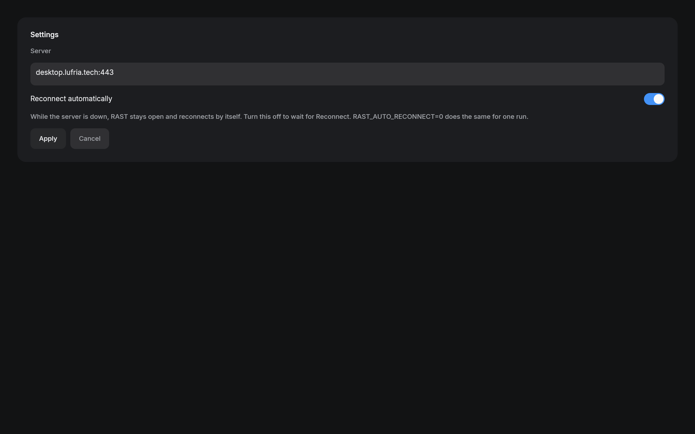

# The RAST client

The first real slice of the rewrite is the **client shell**: a native Rune window
for Linux, Windows and macOS (and a WebGPU wasm build for the browser) that knows
which RAST server it belongs to and survives that server going away.

## Device login

In the browser the shell signs in to the **RAST server** (accounts with the
roles Super Admin, Admin and User, an `HttpOnly` session cookie, and a one-time
setup token for the first Super Admin; see [docs/AUTH-STORAGE.md](AUTH-STORAGE.md)).
Administrators manage accounts in **Control Panel → Users**; everyone can change
their password under **Profile**.

The native shell opens on a **device login**: the first launch asks for a username and a
password (8+ characters), later launches prefill the username, and *Sign out*
returns to the login screen. The classic RAST layout uses the original Alpine
Dawn wallpaper (CC0-1.0), a two-panel desktop view, and a single-column compact
view. In the browser, the form is built with HTML and CSS so zoom and mobile
scrolling do not resize or clear a Rune canvas. The Rune workspace opens only
after the local login succeeds. The password is hashed with **Argon2id** and
never stored in plaintext:

- natively: one `0600` file per OS (paths below).

This is the *device* unlock, not server authentication: the server will
authenticate users itself once the server phase lands. The full recommendation
(device file vs database, and why server accounts belong in SQLite) is in
[docs/AUTH-STORAGE.md](AUTH-STORAGE.md).

## What it does today

- Shows the connection state to the configured RAST server: *Connecting*,
  *Connected*, *Server unreachable*, or *Set up the server* when the address is
  invalid.
- Keeps running while the server is down, and **reconnects automatically** when
  the server comes back — on a backoff of 1 s, 2 s, 4 s, 8 s, 15 s, then every
  30 s. Once connected it re-checks every 10 s (`HEARTBEAT` in
  `crates/rast-ui/src/connection.rs`) so a server that goes away is noticed too.
- Offers a **Reconnect now** action for an immediate attempt, also while
  automatic reconnection is off.
- A **Settings** screen to change the server address and to turn automatic
  reconnection on or off. The choice is persisted immediately, so it survives
  restarts.
- The reachability check is a plain TCP connection to `host:port`, closed at
  once. It tells "server down" from "server up" and will be replaced by a real
  health/API check once the server exists.

Screens (rendered headlessly by `cargo run -p rast-ui --bin rast -- --snap …`):




## Turning automatic reconnection off (optional setup)

Three equivalent ways — the setting is optional and off means *stay offline
until the operator presses Reconnect*:

1. **In the app**: Settings → *Reconnect automatically* switch → **Apply**.
2. **One run**: `RAST_AUTO_RECONNECT=0 rast` (also `false`, `no`, `off`).
3. **By hand**: set `auto_reconnect = false` in the settings file below.

The app still reconnects with **Reconnect now** when automatic reconnection is
off. Nothing polls in the background in that mode.

## Settings file

| OS | Settings file | Device login |
| --- | --- | --- |
| Linux | `$XDG_CONFIG_HOME/rast/client.conf` (usually `~/.config/rast/client.conf`) | `~/.config/rast/device-account` (0600) |
| macOS | `~/Library/Application Support/rast/client.conf` | `~/Library/Application Support/rast/device-account` |
| Windows | `%APPDATA%\rast\client.conf` | `%APPDATA%\rast\device-account` |

`RAST_CONFIG=/path/to/client.conf` overrides the location — useful for portable
setups, test machines and packaging.

```ini
# RAST client settings. Edited by the app's Settings screen; safe to edit by hand.
server = desktop.lufria.tech:443
auto_reconnect = true
```

The server value accepts `host`, `host:port`, `https://host/path`, and bracketed
IPv6 (`[::1]:8720`). The port defaults to 443.

## Build and run

Requirements are the same as the shell in the [README](../README.md): Rust
1.99.1 (pinned) and, on Linux, `libxkbcommon-dev`, `libwayland-dev`,
`libxkbcommon-x11-0` and a Vulkan driver to actually draw.

```sh
cargo run -p rast-ui --bin rast            # native window
cargo test -p rast-ui                      # headless tests, no GPU/display
```

Cross-platform builds are CI jobs ([`.github/workflows/ci.yml`](../.github/workflows/ci.yml)):
`cross-platform` builds and tests on `ubuntu-24.04`, `windows-latest` and
`macos-latest`; `dist` packages release binaries for Linux and Windows on
`workflow_dispatch` or a tag. macOS packaging (a signed `.app` bundle) is not
set up yet: CI builds and tests the macOS binary, but shipping it to users needs
code signing/notarisation first.

Headless renders of every screen (used by CI):

```sh
VK_ICD_FILENAMES=/usr/share/vulkan/icd.d/lvp_icd.json \
  cargo run -q -p rast-ui --bin rast -- --snap out.png --scene offline
# scenes: offline, online, settings, setup
```

## What is deliberately not here yet

- Authentication and the real server API (the server itself is the next phase;
  the TCP probe stands in for it).
- Certificate validation: the client does not speak HTTP yet, so a TCP connect is
  all it can check. When the server exists, this becomes a pinned-HTTPS health
  check.
- Auto-start at login: the app is meant to be started by the user for now. If
  "turn on" should also mean *launch at login*, that is a small addition on top
  of this shell (desktop entry / LaunchAgent / Run key) and needs its own
  switch to turn it off.
