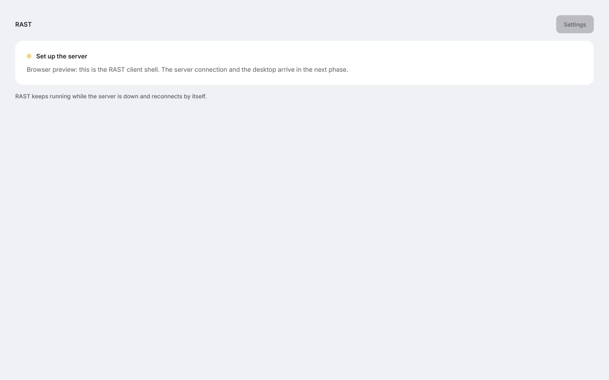

# Deployment

This page is the honest state of deploying the rewrite. Read it before touching
`desktop.lufria.tech`.

## desktop-revamp.lufria.tech (the new hostname)

The maintainer created `desktop-revamp.lufria.tech`. Checked on 2026-11-21: DNS
resolves through Cloudflare, but the edge answers **404** because the tunnel's
ingress has no rule for the hostname (`/etc/cloudflared/config.yml` has no
`desktop-revamp` entry and still ends with the catch-all `http_status:404`).

This session cannot add it: the host filesystem is read-only outside the
checkout and `sudo` is blocked, so `/etc/cloudflared` and `/etc/nginx` are out of
reach. The last step is **one root command** on the host:

```sh
cd /home/lufria/RAST && git pull
scripts/web-build.sh          # rebuild the browser bundle (needs wasm-bindgen-cli)
sudo deploy/install-revamp.sh
```

`deploy/install-revamp.sh` is idempotent and does, with a check after each step:

1. copies `dist/web` to `/srv/rast-static/revamp`;
2. installs `deploy/nginx-revamp-site.conf` as an nginx site on
   `127.0.0.1:8722` and reloads nginx;
3. inserts `desktop-revamp.lufria.tech -> http://127.0.0.1:8722` into the
   Cloudflare Tunnel ingress (backs up `config.yml` first, then
   `cloudflared tunnel ingress validate`, then `systemctl reload-or-restart cloudflared`);
4. checks the site on `127.0.0.1:8722` and then on
   `https://desktop-revamp.lufria.tech/`.

`https://desktop.lufria.tech/` keeps serving the released RAST: it is a
different nginx server block and a different tunnel hostname. Undo steps are in
the script's header.

DNS must already point the hostname at the tunnel (Cloudflare dashboard: a
proxied `CNAME` to `<tunnel-id>.cfargotunnel.com`, or
`cloudflared tunnel route dns <tunnel-name> desktop-revamp.lufria.tech`). The
script's last step fails with that hint if the public URL does not come up.

Until that runs, the browser build is verified locally: the wasm page boots
under the production CSP with WebGPU (headless Chromium, SwiftShader) and shows
the client shell.



## Current production is not this code

`desktop.lufria.tech` still runs the **last released RAST 1.0.1-alpha.2** from
branch `Remake`. The rewrite on `revamp/remake` does not replace it, and this
repository does not contain a server yet — only the client shell.

Probed read-only on 2026-11-21: `https://desktop.lufria.tech/` answers `HTTP 200`
and the installed `rast` service is active.

## Why the rewrite cannot be deployed yet

1. **There is nothing to serve.** The rewrite has no server, no auth, no API, no
   session handling and no desktop/apps. Deploying it to the production domain
   would replace a working product with a connection-status window.
2. **Deploying is a root operation on the host**, not something this repository's
   sandbox can do: installing a release, `systemctl`, nginx vhosts, `/etc/rast`,
   `/var/lib/rast` and `/srv/rast` all live outside the workspace and need the
   maintainer.
3. **Production doubles as the test host.** A mistake there is visible to real
   users immediately, and there is no separate VM to fall back to.

## What exists today for deployment

- `dist` CI job: release binaries for Linux and Windows (`.github/workflows/ci.yml`,
  `workflow_dispatch` or a tag). macOS builds are tested but not packaged yet.
- `scripts/web-build.sh`: the browser build, a static folder.
- No server package, no systemd unit, no nginx site for the rewrite yet.

## Safe plan for the first real deployment (staging first)

Do not touch `desktop.lufria.tech` until the rewrite has a server that can at
least authenticate. The sequence:

1. **Staging vhost**: add a separate hostname or port
   (e.g. `revamp.desktop.lufria.tech`) pointing at the rewrite's server, while
   the old instance keeps serving `desktop.lufria.tech`.
2. **Test accounts only** on staging; never real users, never real shared
   folders.
3. Health check: sign in, open a window, verify a file round-trips through the
   new server, check logs for errors.
4. **Cutover in a maintenance window**: keep the old release installed, note its
   version for rollback, back up `/etc/rast`, `/var/lib/rast`, `/srv/rast`.
5. **Rollback**: stop the new units, restore the vhost to the old backend, and
   reinstall the previous release with
   `sudo rast update --version <previous version>`.

## Until then

- Production: unchanged; do not run `rast update` for the rewrite.
- Rewrite: build it in CI, run the client locally against any address (default
  `desktop.lufria.tech:443` only tells you the host is up), and use the
  client's Settings screen to point test machines at whatever test server the
  server phase produces.

## What this development session can and cannot do

The session that writes this repository runs in a sandbox **inside the production
host**, and that sandbox can only write inside the checkout. Verified on
2026-11-21:

- `/etc/nginx/conf.d`, `/srv/rast`, `/var/www`, `/opt`, `/usr/local/share` →
  `Read-only file system`.
- `sudo` refuses: *"The no new privileges flag is set"*; `docker` socket:
  *permission denied*.
- What serves the domain: **Cloudflare Tunnel** (`/etc/cloudflared/config.yml`,
  root-owned) → nginx `127.0.0.1:8721` → RAST `127.0.0.1:8720`. Both configs are
  root-owned and read-only to the session; the old app's frontend is embedded in
  its binary, so there is no static directory to drop files into either.
- Rootless alternatives were tried and do not work here: account-less
  Cloudflare quick tunnels register but the edge answers `404`, and Tailscale
  Serve is not enabled on the tailnet.

So the last step — one root command block, or a one-line tunnel ingress change —
has to come from the maintainer (or from a session started with a writable
deploy path). The repository side is ready:

- `deploy/nginx-revamp.conf` — a `location /revamp/` snippet that serves the new
  client **next to** the running desktop at `/`.
- `scripts/publish-web.sh` — builds the bundle and prints the exact root
  commands.
- `scripts/serve-web.py` — dev server with the right `.wasm` MIME type.

## Option A — publish the browser build now, without touching production

This keeps `https://desktop.lufria.tech/` on the old app and adds
`https://desktop.lufria.tech/revamp/` with the new client shell:

```sh
# as root on the host, from this checkout
install -d -m 0755 /srv/rast-static/revamp
rsync -a --delete dist/web/ /srv/rast-static/revamp/
install -d -m 0755 /etc/nginx/snippets
install -m 0644 deploy/nginx-revamp.conf /etc/nginx/snippets/revamp.conf
# one-time edit: add `include /etc/nginx/snippets/revamp.conf;` inside the
# `server { ... }` block of /etc/nginx/sites-available/rast (before `location / {`)
nginx -t && systemctl reload nginx
```

Undo: delete the `include` line, `nginx -t && systemctl reload nginx`.

Note that the browser build is a **preview**: it shows the client shell and says
so; it does not connect to a server yet (no server exists in the rewrite).

## Option B — let this session deploy

Either:

1. make a deploy directory visible and writable from the checkout (for example a
   bind mount of `/srv/rast-static/revamp` as `deploy-target/`), and add the nginx
   `include` once; after that `rsync`ing a new build is a no-root operation; or
2. add one ingress line to `/etc/cloudflared/config.yml`
   (`hostname: revamp.desktop.lufria.tech` → `http://127.0.0.1:8765`), reload
   `cloudflared`, and this session can serve the build on that hostname; or
3. run Option A above once and then hand builds over by uncommenting the nginx
   location — the maintainer decides which channel is acceptable.
