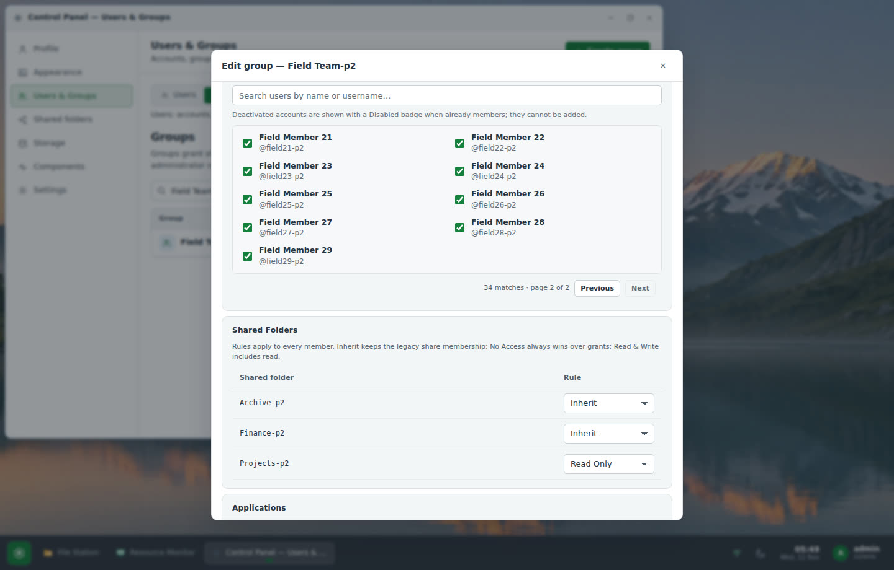
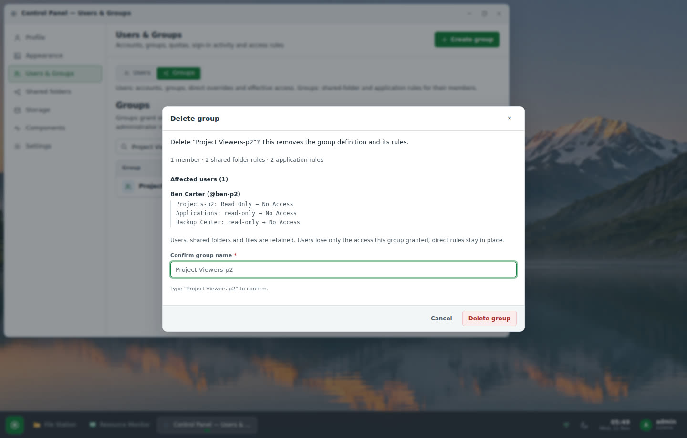
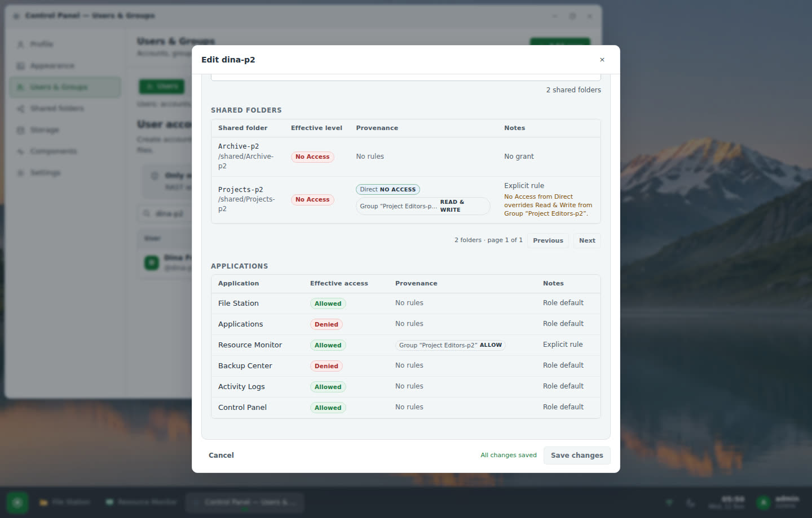
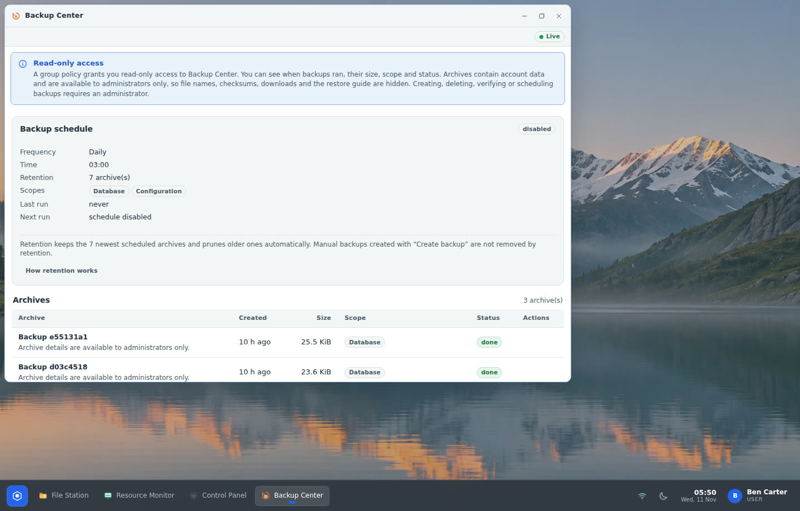
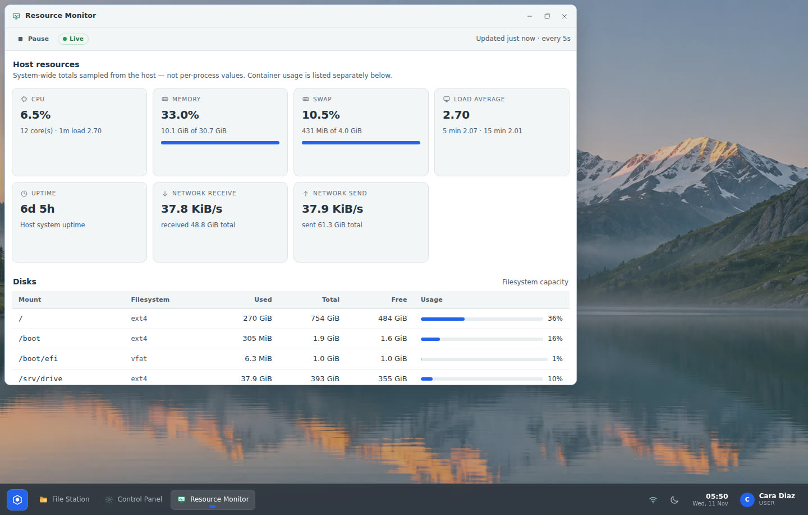
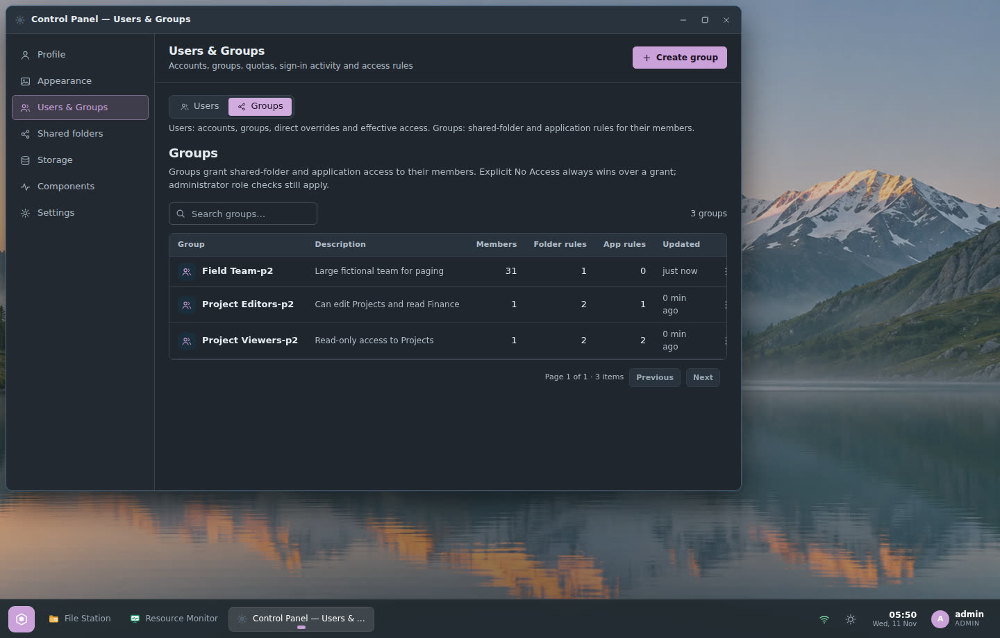
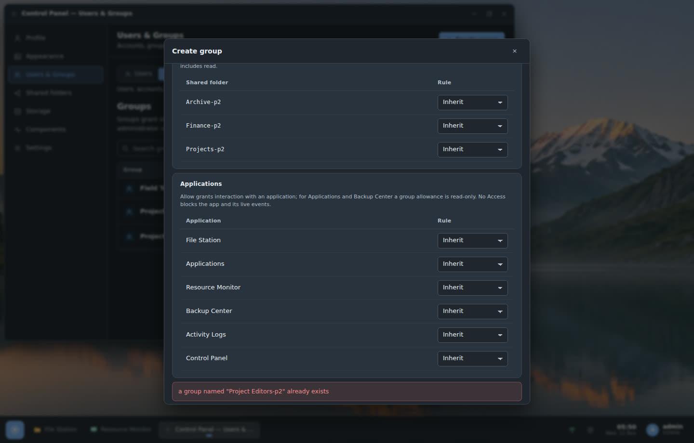
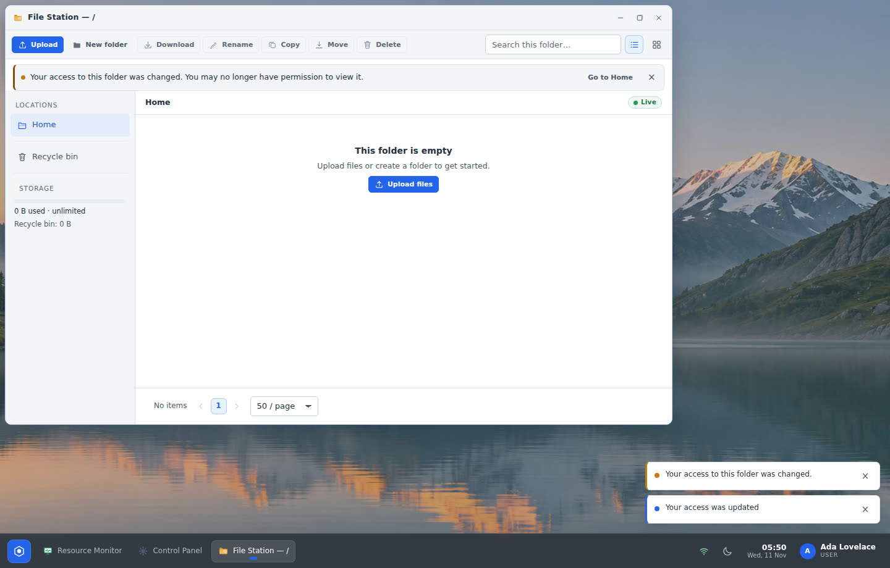

# Audit & hardening handoff — RAST 0.2.0 → 0.3.0

This document records a full audit of RAST after the Users & Groups release,
the fixes and improvements that followed, how they were verified, and the
release and deployment state. It is written for operators and contributors;
all accounts, groups, folders and files in tests and screenshots are
fictional (`ada`, `ben`, `cara`, `dina`, `erin`, `Project Editors`,
`Projects`, `Finance`, …). The previous handoff
([user-groups-handoff.md](user-groups-handoff.md)) is treated as historical
evidence; where this audit contradicts it, this document wins.

## 1. Versions and commits

| | Start | End |
| --- | --- | --- |
| Release | v0.2.0 (tag commit `7513dc7`) | **v0.3.0** (tag commit `12460eb`) |
| `main` | `d436d53` | `7f0521b` + this handoff commit |
| SQLite schema | v4 (`0004_groups`) | **v5** (`0005_share_rule_ids`) |
| Production (desktop.lufria.tech) | `RAST 0.2.0 (7513dc7ecfe6)`, schema v4 | **`RAST 0.3.0 (12460ebd2045)`, schema v5** |
| Tests | 284 lib + 22 e2e | **297 lib + 27 e2e** |

Starting state was verified, not assumed: `git status` clean on `main`
tracking `origin/main`, production reported `RAST 0.2.0 (7513dc7ecfe6)`,
`rast doctor` "schema v4, 0 warnings", all gates green (fmt, clippy
`-D warnings`, 284 + 22 tests, `tsc`, Vite build).

## 2. Areas audited

| Area | Reviewed | Outcome |
| --- | --- | --- |
| Authentication & sessions | login/rate limit, cookies (`HttpOnly; SameSite=Lax; Secure` behind TLS), CSRF + Origin on mutations, per-request account reload, password change/reset, session revocation, last-admin safeguard | F9 fixed; rest OK |
| Users & Groups | direct overrides, group rules, legacy ACL fallback, conflicts, Effective Access vs enforcement, revocation | F5, F6, F12, F13 fixed |
| File Station | share visibility, home isolation, read/write paths, quotas, uploads, previews, recycle bin, job-start recheck | No new defect; cross-checked by the Effective-Access ⇔ API test |
| Applications & Docker worker | read-only payloads, env/secrets, logs + live log stream, history, Compose sandbox, worker privileges | F2, F7 fixed; sandbox/worker OK (see open findings) |
| Monitoring, Activity Logs, SSE | metric scope, log scoping, per-event authorization, live permission changes, reconnection | F8 fixed; logs/SSE scoping OK |
| Backup Center | archive contents, list/download permissions, SQLite consistency, retention, restore | F1, F4, F14 fixed |
| Installer, updater, releases | artifact verification, systemd sandbox, migrations, clean install/upgrade/rollback | F3 corrected, F10 implemented |
| UI & accessibility | tokens, controls and states, contrast, keyboard focus, dialogs/tables/errors, small windows | F11, F15 fixed |

## 3. Confirmed findings

Priority: **P1** access/confidentiality/data integrity, **P2** security
hardening/reliability, **P3** usability. Every finding below was reproduced
or proven from code before it was fixed.

| ID | Pri | Finding (evidence) | Fix | Commit |
| --- | --- | --- | --- | --- |
| F1 | P1 | `src/api/backup.rs` `download_backup` and `restore_guide` accepted the read-only Backup Center grant. Archives contain `db/rast.db` (password/session hashes), `config/secret.key` (decrypts app secrets), `rast.toml` and optionally every user's files. A v0.2.0 unit test asserted the download was allowed. | Download + restore guide admin-only; read-only list returns metadata only (`fileName`/`sha256`/`note` blank, generic error, `downloadable:false`); downloads audited (`backup.download`). | `c7eba9d` |
| F2 | P1 | `src/api/apps.rs`: read-only Applications grant received non-secret env values, full container logs (REST + SSE stream), history `detail` and Docker reasons with socket paths. | Read-only gets `envCount`/`secretCount`, no `env`/`compose`, first line of `lastError`; logs and stream admin-only; history without `detail`; generic Docker reason. | `8ffc1cc` |
| F3 | P1 | The v0.2.0 handoff said older binaries "ignore the group tables". Reproduced on an isolated copy: v0.1.8 on schema v4 exits with `migration 4 was previously applied but is missing`. A pre-0.2.0 binary also never evaluates group deny rules. | Rollback procedure rewritten (restore DB first, then binary; access-widening warning); restore guide carries a `rollback` note. | `c7eba9d`, `20afbe4` |
| F4 | P1 | Restore guide command `tar -xzf ARCHIVE -C / --strip-components=2 users/` extracts every home/shared folder **directly into `/`** (reproduced on an isolated archive). | Commands target `<storage>/homes` and `<storage>/shared` with `--strip-components=2 users/homes` / `users/shared`, plus chown and isolated-copy guidance. | `c7eba9d`, `20afbe4` |
| F5 | P1 | Folder rules were keyed by share **name**; rename used `UPDATE OR REPLACE`, silently dropping a conflicting rule. | Migration `0005`: rules keyed by `shares.id` (`ON DELETE CASCADE`), renames untouched, orphans/conflicts counted; API accepts `shareId`/`shareName`, returns both. | `128d3f8` |
| F6 | P2 | v0.2.0 regression: `created_by == user` granted **Admin** on the share when no rule applied — a demoted former admin kept full access. v0.1.8 never had this. | Owner fallback removed (admin bypass + legacy `share_members` only). | `128d3f8` |
| F7 | P2 | Live log stream authorized only at connect; after revocation/demotion/disable it kept streaming. | Session + active-admin revalidated before every incremental poll (after the interval wait). | `8ffc1cc` |
| F8 | P2 | Resource Monitor (default-allowed) exposed host-wide container names/ids and overlay mount paths to every account, also via SSE. | Inventory only for admins / Applications users, per request and **per live sample**; runtime/virtual mounts hidden for everyone. | `736c587` |
| F9 | P2 | `must_change_password` enforced only by the UI dialog; the API served everything. | Server returns 403 for all endpoints except `me`, `password`, `logout`, `events`. | `0ad100e` |
| F10 | P2 | Releases verified only against `SHA256SUMS` from the same release (integrity, not origin); aarch64 build-only. | Sigstore build-provenance attestations for both binaries + `SHA256SUMS`, verified in the workflow; native runtime smoke on x86_64 and arm64; installer `--verify-attestation`. | `20afbe4`, `7f0521b` |
| F11 | P3 | Light `--text-faint` 3.09:1 on white / 2.83:1 on `surface-2`; primary disabled label ≈2.1:1; dark `.form-error` 3.21:1. | Tokens and shared control states adjusted (table in §6). | `f8814c8`, `07ebbaf` |
| F12 | P3 | Member pickers loaded the first 100 accounts; deactivated members hidden; selection lost across pages. One/two-character account searches returned everything. | Server search + pagination, persistent selection, Disabled members listed; search fixed + `active=` filter. | `f2e1db0`, `043c60e`, `0ad100e` |
| F13 | P3 | Effective Access returned every share unpaginated, no search/filter, no conflict explanation; "No grant" folders were labelled "Legacy share membership". | Search/level filter/pagination from the evaluator, `conflict` field, correct `none` fallback, deletion impact preview. | `f2e1db0`, `59abd15`, `9cc8a2f`, `043c60e` |
| F14 | P2 | Found during the restore drill: `rast restore` refused whenever *any* `rast.service` was active and did **not** detect a server started any other way, so it could replace the DB under a live server. | `<data_dir>/rast.lock` held by `rast serve`; restore takes the same lock; a second server on a data dir refuses to start. | `a5926ea` |
| F15 | P3 | Found in browser verification: the shared save workflow swallowed server errors (e.g. 409 duplicate group name showed "Unsaved changes" and nothing else). | Error banner stays visible with "Try again" until the draft changes. | `043c60e` |

Two defects were found in this work's own code during review and fixed before
release: the deletion-impact preview initially evaluated the post-deletion
state inside a rolled-back write transaction (held the SQLite write lock) —
replaced by read-only evaluation (`59abd15`); and an SSE regression test was
timing-sensitive under load — made frame-driven (`09cc634`).

### Reviewed without a defect

- Session middleware reloads role/active on every request; SSE revalidates
  sessions every 20 s and filters each event with the generation-aware
  evaluator; access changes reach open streams immediately.
- Jobs API is owner/admin scoped; copy/move/delete jobs re-check permissions
  at start (re-verified by the revocation tests).
- Activity Logs force `user_id = self` for non-admins on list/actions/export.
- Compose sandbox rejects privileged mode, host network/PID/IPC, devices,
  external volumes, `volumes_from` and bind mounts outside the app directory.
- `rast.service`: no capabilities, `ProtectSystem=strict`, `RestrictNamespaces`,
  `ReadWritePaths=/var/lib/rast /srv/rast`; the worker runs as `rast-worker`
  with only the `docker` group.
- Installer and `rast update` verify SHA-256 and probe the binary version
  before replacement; `rast update` takes a db+config backup first.

## 4. Permission behaviour changes administrators should know

1. **Read-only Backup Center** = status only. Viewers see when backups ran,
   size, scope and outcome. File names, checksums, notes, downloads and the
   restore guide are for administrators only.
2. **Read-only Applications** = status only. No environment values (counts
   only), no container logs, no deployment error details.
3. **Resource Monitor** shows container details only to administrators and
   accounts allowed to use Applications.
4. **No implicit access for share creators.** If a non-admin account relied
   on having created a share (only possible if it was an admin then), grant
   access with a group or direct rule. Production had no such case.
5. **Folder rules follow the share**, not its name: renaming keeps rules,
   deleting a share removes its rules.
6. **Forced password change** blocks the API until the password is changed.
7. **One server per data directory**; `rast restore` refuses while a server
   uses the same data directory.

## 5. Migrations, upgrade, rollback and recovery

### Migration 0005

`0005_share_rule_ids.sql` rebuilds `group_folder_rules` and
`user_folder_rules` keyed by `share_id REFERENCES shares(id) ON DELETE
CASCADE`, mapping v4 rows by `shares.name COLLATE NOCASE` with
`INSERT OR IGNORE`, preserving `updated_at`. Rules whose share no longer
existed had no effect; they are dropped and counted in
`settings['migration.0005.orphaned_rules']`, duplicate collisions in
`settings['migration.0005.conflicts']`.

### Verified upgrade (isolated, fictional data)

1. Published, checksum-verified **v0.2.0** created a schema-v4 installation:
   5 accounts, 3 shares, 2 groups with read/write/deny rules, a direct deny,
   two legacy `share_members` rows, two custom appearance profiles.
2. Snapshot of every account: effective level per folder, application
   state, groups, appearance, and the account's **own** API status for
   listing each folder.
3. `sqlite3 .backup` of the v4 DB (integrity `ok`, migrations 1–4).
4. The new build started on an isolated copy → migrations `1,2,3,4,5`,
   `orphaned_rules=0`, `conflicts=0`.
5. Same snapshot → **0 differences** across 6 accounts, 18 folder decisions,
   36 application decisions, 15 per-account API listing checks, all
   appearance preferences, groups and shares.

The migration unit test additionally covers orphans (2 counted), conflicts
(0), identical effective permissions, `updated_at` preservation, rename and
cascade.

### Verified rollback and restore (isolated copies)

| Drill | Result |
| --- | --- |
| v0.2.0 binary on the upgraded schema-v5 DB | refuses to start: `migration 5 was previously applied but is missing in the resolved migrations` (exit 1) |
| Documented rollback: restore the pre-upgrade `.backup`, then run v0.2.0 | healthy; snapshot vs pre-upgrade: **0 differences** |
| `rast restore --from <archive> --yes` (current build) | dry-run OK; restore OK; a group written **after** the backup is gone (expected) and preserved in `backups/pre-restore-*`; server healthy; snapshot: **0 differences** |
| Restore while a server runs on the data dir | refused: "a RAST server is running on this data directory" |
| User-file restore commands from the guide | files land in `homes/` and `shared/` of the scratch storage, nothing outside |

### Recovery guidance (also in `docs/OPERATIONS.md`)

- **Prefer fix-forward.** Migrations are forward-only; an older binary will not
  start on a newer schema.
- To roll back: stop `rast.service` → keep a copy of the current DB → restore
  the pre-upgrade backup → install the older binary → start → verify.
  Everything written after the backup (accounts, rules, audit rows, uploads
  metadata) is lost unless re-applied manually from the kept copy.
- **Authorization when rolling back:** to 0.2.0 the share-name rules come back
  as they were at backup time (including the creator fallback fixed in F6);
  below 0.2.0 group rules are not evaluated at all, which **widens access** —
  review shared-folder memberships and active sessions immediately.
- Restore user files only into the storage roots and test on an isolated copy
  first.

### Production upgrade performed

1. `sqlite3 .backup` of `/var/lib/rast/rast.db` to a root-only file under
   `/root/` (integrity `ok`, migrations 1–4).
2. Release installer (SHA-256 verified) → `RAST updated from 0.2.0 to 0.3.0`,
   health check passed.
3. `rast doctor`: schema v5, worker OK, 0 warnings; `orphaned_rules=0`,
   `conflicts=0`; appearance rows unchanged; `rast.lock` owned by `rast`.

## 6. Verification results

Environment: Ubuntu x86_64, 12 cores / 30 GiB; Rust 1.99.1 (pinned), Node 24;
headless Chromium (Playwright) 1440×920 and 390×844.

### Automated

| Check | Command | Result |
| --- | --- | --- |
| Rust format / lint | `cargo fmt --all -- --check`, `cargo clippy --all-targets --locked -- -D warnings` | clean |
| Rust tests | `cargo test` | **297 lib + 27 e2e passed** (run twice in full) |
| Frontend | `npx tsc --noEmit && npm run build` | 0 errors; JS 404.8 kB (gzip 114.2), CSS 164.3 kB (gzip 30.5) |
| Scripts / workflows | ShellCheck, `sh -n`, actionlint, yamllint, installer-asset sync, license inventory | clean |
| CI on `main` and tag | GitHub Actions | green (6/6 jobs); Release 5/5 jobs incl. native runtime smoke + attestation verification |

New regression tests (fictional accounts):

- **Effective Access ⇔ API**: 5 accounts × 3 folders — `none` ⇔ list/upload
  404, `read` ⇔ list 200 + upload 403, `write` ⇔ list 200 + upload 200; covers
  direct deny vs group write, legacy ACL write, conflict explanation, search /
  level filter / paging, `/api/access/me` hiding denied folders.
- Read-only Backup: metadata only, download/guide 403; admin download audited;
  restore command never targets `/`.
- Read-only Applications: no env/compose, logs + stream 403, no history detail.
- Demoted share creator: 404 and `none`.
- Group members paging (30 members, deactivated member listed, 2-character
  search) and deletion impact (`write → none`, `read-only → none`) without
  side effects.
- Forced password change: 403 before, 200 after changing.
- SSE: restricted monitor sample has no inventory; after a live grant the next
  sample on the **same open stream** includes it; `access.changed` delivered.
- Log stream ends when the admin is demoted between polls.
- Migration 0005 upgrade and instance-lock restore guard.

### Production smoke (through Cloudflare + nginx)

`tests/smoke.sh https://desktop.lufria.tech`:
- before deploy (v0.2.0, v0.2.0 script): **85 passed, 0 failed, 0 skipped**;
- after deploy (v0.3.0, extended script): **91 passed, 0 failed, 0 skipped**,
  including the read-only Applications/Backup boundaries (archive download 403
  for the viewer, 200 for the administrator), Effective Access search,
  membership revocation and group-delete retention, Docker worker checks.

### Browser workflows (real backend, fictional data)

`audit-verify` script, **38/38 checks** locally and **38/38 on production**:
member picker paging with a 30-member group (selection kept across search and
pages, deactivated member shown and kept on save), delete impact preview,
Effective Access conflict line, live revocation in an already-open File
Station (new requests 404, listing cleared with an access message),
read-only Backup Center and Monitor states, light/dark × 6 accents applied
live, dark dialog error state, WCAG AA text contrast measured on rendered
Control Panel nodes in both themes (worst 4.98:1 light, 5.35:1 dark),
390 px without horizontal overflow, no page errors.

Contrast of shared tokens (computed on rendered surfaces):

| Pair | Light | Dark |
| --- | --- | --- |
| hint / faint text on surface-2 | 4.98:1 (was 2.83) | 5.35:1 (was 4.36) |
| faint text on surface | 5.44:1 (was 3.09) | 6.28:1 |
| table header | 6.44:1 | 6.82:1 |
| disabled button label | 4.98:1 (primary was ≈2.1) | 5.35:1 |
| warning badge | 6.25:1 | 7.11:1 |
| selected segment (accent) | 5.17:1 | 8.04:1 |
| accent-fg on accent, all 10 presets | ≥ 4.99:1 | ≥ 7.97:1 |

### Screenshots (production, fictional data)

| | |
| --- | --- |
|  |  |
|  |  |
|  |  |
|  |  |

Mobile: [390 px Users & Groups](screenshots/audit-mobile-groups.jpg).

### Resource measurements

Equivalent conditions: same machine, same isolated fictional database copy,
release binaries of v0.2.0 (published) and the candidate, 60 s idle with no
clients, then 3 SSE clients + 400 authenticated requests (including Effective
Access for every account). Five alternating rounds; the table shows medians
of the final three-round set.

| Build | Idle CPU | Idle RSS | CPU under load | RSS under load | p50 | p95 | Errors |
| --- | --- | --- | --- | --- | --- | --- | --- |
| v0.2.0 | 0.30 % | 10 MiB | 25.2 % | 12 MiB | 0.86 ms | 1.28 ms | 0 |
| v0.3.0 candidate | 0.30 % | 10 MiB | 23.0 % | 12 MiB | 0.75 ms | 1.15 ms | 0 |

Per-round load CPU and p95 swung both ways between builds (single rounds from
21.7 % to 40.5 %), so the difference is **within host noise**: no measurable
regression or improvement. Production after a clean restart (60 s idle, no
clients): v0.2.0 `rast` 0.15 % / 14.8 MiB (measured at the start of the
audit, service up for ~20 min) vs v0.3.0 `rast` 0.22 % / 10.7 MiB, worker
0.03 % / 7.6 MiB, total 18.3 MiB.

## 7. Open findings

| ID | Impact | Next action |
| --- | --- | --- |
| O1 | `rast update` verifies SHA-256 and the version but not build provenance; attestation enforcement exists in the installer only. | Add optional provenance verification to `rast update` (sigstore verification library or `gh` when present), fail closed when requested. |
| O2 | The Docker worker is root-equivalent by design (docker group); the Compose sandbox reduces but cannot remove that trust. | Keep Applications admin-only for mutations; consider rootless Docker/podman support and per-app user namespaces. |
| O3 | Release artifacts are not signed with a project key (keyless provenance only). | Decide on a minisign/cosign key policy; the installer already supports `RAST_REQUIRE_SIGNATURE`. |
| O4 | ARM64 is runtime smoke-tested in CI but the full installer/systemd flow is exercised on x86_64 only. | Add an arm64 clean-container installer job when arm64 runners with systemd containers are available. |
| O5 | Effective Access evaluates every share for each page request (cached per account); fine for hundreds of shares, untested beyond that. | Measure with thousands of shares; add a bulk evaluator if needed. |
| O6 | Background copy/move/delete job audits are not broadcast live, and external filesystem changes do not update quota usage (carried over from earlier releases). | Publish job audit events; schedule a periodic quota rescan. |
| O7 | `gh attestation verify` needs GitHub authentication even for public repositories, which makes `--verify-attestation` unusable on hosts without a GitHub login. | Document (done); evaluate an offline verifier for air-gapped hosts. |

## 8. Commit, branch, push, release and deployment status

**Branch:** `main` → `origin` (`https://github.com/Enricko/rast`). No force
pushes.

**Commits** (oldest first; each reviewed with its staged diff and the relevant
checks before committing):

| Commit | Change |
| --- | --- |
| `c7eba9d` | fix(access): scope backup artifact downloads to administrators |
| `736c587` | fix(access): limit container inventory in Resource Monitor |
| `8ffc1cc` | fix(access): restrict Applications logs and env to administrators |
| `0ad100e` | fix(auth): enforce forced password changes on the server |
| `128d3f8` | fix(access): key folder rules by stable share id and drop owner fallback |
| `f2e1db0` | feat(groups): paginate member search and explain effective access |
| `59abd15` | fix(groups): evaluate deletion impact without a write transaction |
| `9cc8a2f` | fix(access): report no-grant folders as 'none' instead of legacy ACL |
| `f8814c8` | fix(ui): raise text contrast and complete shared control states |
| `043c60e` | feat(groups): paginate member pickers and Effective Access in the UI |
| `07ebbaf` | feat(ui): present read-only boundaries in Applications, Backup and Monitor |
| `20afbe4` | ci(release): attest build provenance and smoke-test both architectures |
| `430795e` | docs: record hardened access boundaries and share-id folder rules |
| `a5926ea` | fix(backup): guard restores with a data-directory instance lock |
| `09cc634` | test: make the SSE monitor redaction regression deterministic |
| `12460eb` | chore(release): prepare v0.3.0 (**tag `v0.3.0`**) |
| `4b8dd23` | test(smoke): cover read-only Applications/Backup boundaries |
| `7f0521b` | fix(installer): explain attestation failures caused by missing GitHub auth |
| *(this file)* | docs: add audit and hardening handoff |

**Push status:** every commit above is pushed; `main` equals `origin/main`.
CI is green on every pushed commit checked (latest runs: `42967460753` for
the tag commit, `42967825710` for the smoke extension).

**Release status:** [v0.3.0](https://github.com/Enricko/rast/releases/tag/v0.3.0),
run `42967463304` (success, 5/5 jobs). Six assets; `SHA256SUMS` verifies all
five others; `install.sh` pinned to v0.3.0; `latest/download` redirects to
v0.3.0. Build-provenance attestations for `rast-linux-x86_64`,
`rast-linux-aarch64` and `SHA256SUMS` verified in the workflow and
independently with `gh attestation verify` (SLSA v1 provenance, workflow
`release.yml@refs/tags/v0.3.0`). Native runtime smoke passed on x86_64 and
arm64. Clean systemd container installer suite against the published
artifacts with in-container attestation verification: **65/65**. Commits
after the tag (`4b8dd23`, `7f0521b`, this handoff) change tests, installer
diagnostics and docs only; they ship with the next release.

**Deployment status (separate from push):** https://desktop.lufria.tech runs
**RAST 0.3.0 (`12460ebd2045`)**, schema v5, `rast.service` and
`rast-worker.service` active, `rast doctor` 0 warnings, public UI and
`/healthz` 200, production smoke 91/91, browser workflow 38/38. The
pre-migration database backup is kept as a root-only file on the host. All
test accounts, groups, shared folders, archives and home directories created
during verification were removed afterwards; pre-existing data was left
untouched and the administrator's appearance settings were unchanged.
