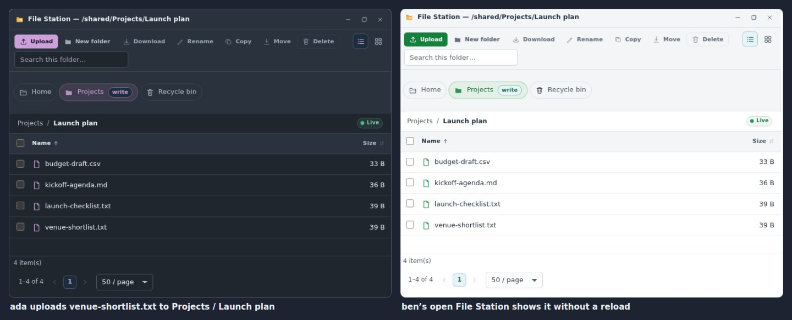
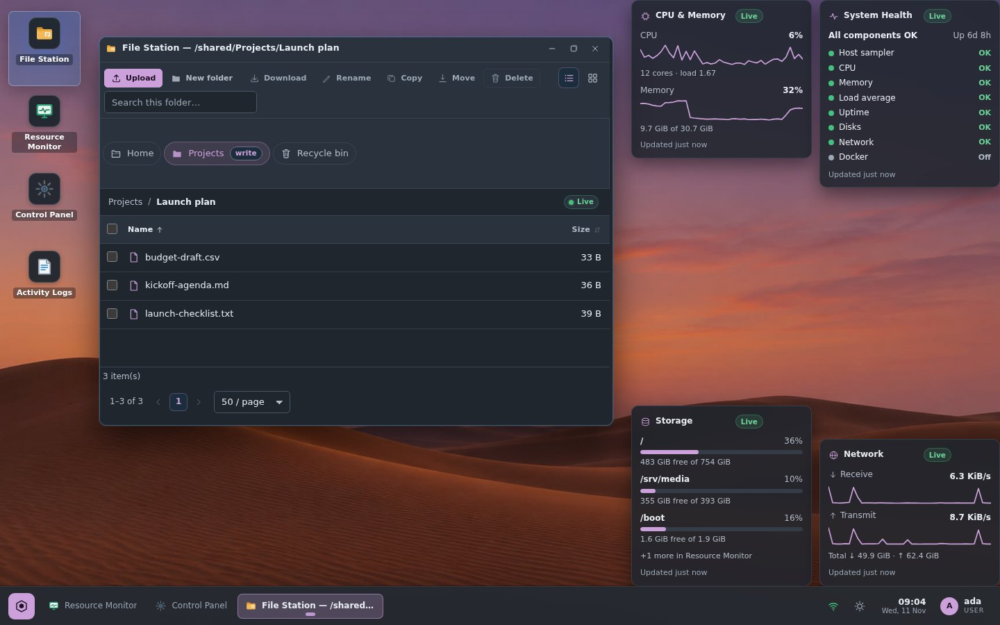
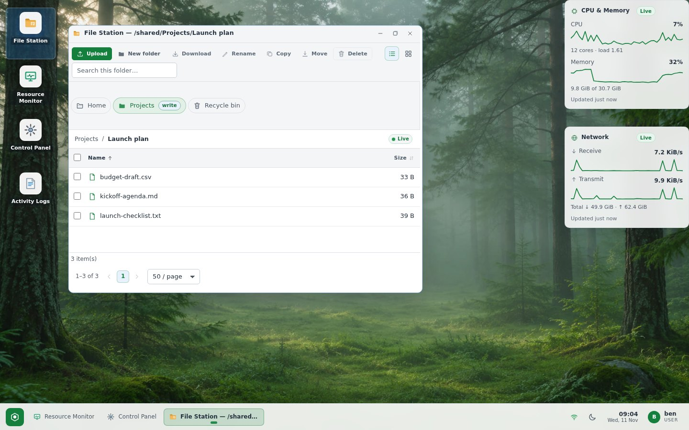
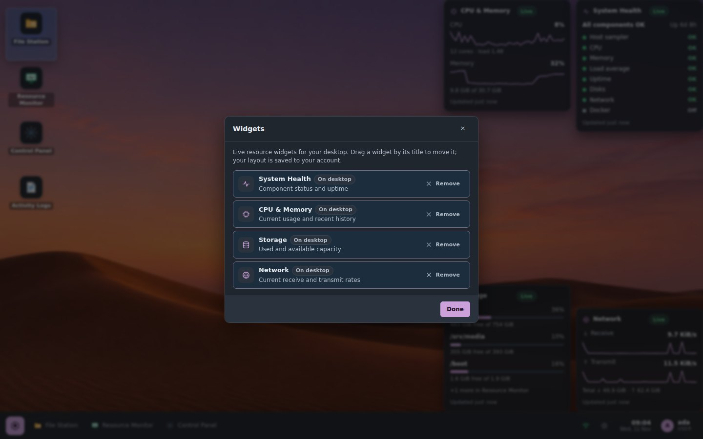
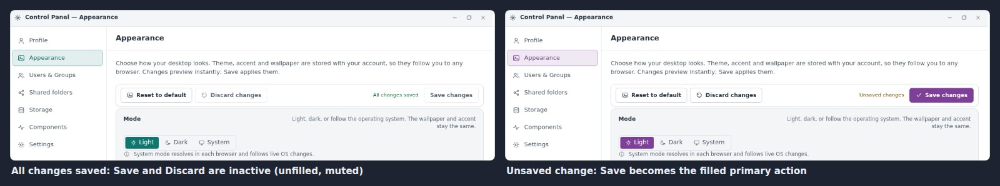
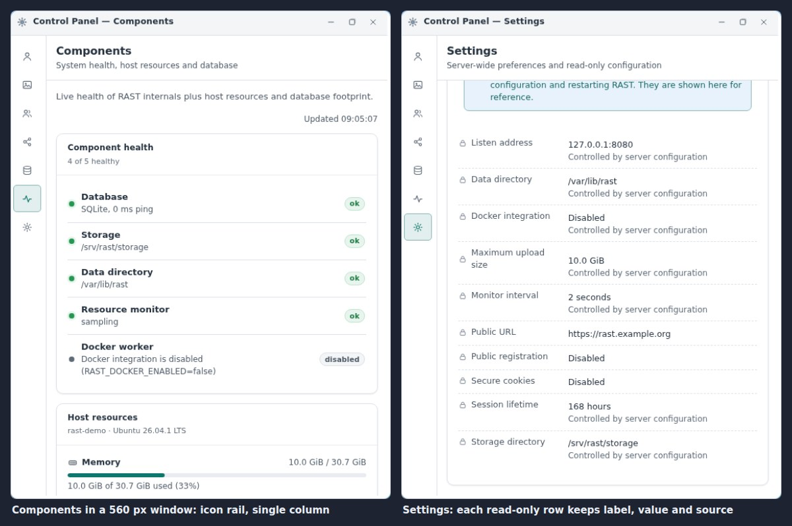

# Desktop reliability handoff — after v0.3.0

This document records the desktop work that followed the v0.3.0 audit
([audit-hardening-handoff.md](audit-hardening-handoff.md)):
- taskbar theming;
- cross-account shared-folder updates;
- desktop resource widgets;
- the Appearance Save controls;
- per-account appearance persistence;
- layouts that follow the window size.

It also covers two defects found while verifying that work.

All accounts, folders and files in tests and screenshots are fictional (`ada`,
`ben`, `admin`, `Projects / Launch plan`, …). In the screenshots, host
identifiers (hostname, data paths, device names, bind address) are replaced by
neutral values, such as `rast-demo` and `/var/lib/rast`.

## 1. Versions and commits

| | Start | End |
| --- | --- | --- |
| `main` | `878b042` | `e03fee4` + this handoff commit |
| SQLite schema | v5 (`0005_share_rule_ids`) | **v6** (`0006_appearance_widgets`) |
| Release | v0.3.0 | v0.3.0 (no new tag) |
| Production (desktop.lufria.tech) | `rast 0.3.0` | `rast 0.3.0`, **not updated** (see §10) |
| Tests | 297 lib + 27 e2e | **305 lib + 30 e2e**, 18 frontend unit tests |

| Commit | Change |
| --- | --- |
| `6c8db14` | fix(files): deliver shared-folder updates to authorized admins |
| `41fb3b9` | fix(appearance): keep each account's saved appearance intact |
| `dab314d` | fix(desktop): theme the taskbar with the selected mode and accent |
| `583d326` | feat(desktop): add resource widgets (migration 0006) |
| `7d6810d` | fix(appearance): make the Save controls reflect the form state |
| `c4f72a3` | fix(desktop): lay out application windows by their own size |
| `8e619a6` | fix(appearance): revalidate private wallpapers on every use |
| `e03fee4` | fix(access): never cache a decision read before a policy change |

All eight are pushed to `origin/main`, and the CI workflow passed for each one.

## 2. Taskbar theming (`dab314d`)

**Symptom.** Hovering the pinned Resource Monitor button made its label
unreadable. The taskbar also ignored the accent colour.

**Cause.** DevTools (`CSS.getMatchedStylesForNode` with a forced `:hover`)
showed that `.taskbar-app.is-pinned:hover { color: var(--text) }` in
`shell.css` (specificity 0,3,0) beat the later theme rules (0,2,0). A pinned
app that is not running therefore took the page text colour on hover: in
light mode, dark text on the always-dark taskbar. The other states used
hard-coded white overlays, `#fff` labels and a fixed blue marker.

**Fix.**
- `styles/taskbar.css`, loaded last, is now the only stylesheet that colours
  the taskbar. Its `--taskbar-*` tokens derive from the surface, text and
  accent tokens, so light, dark, System and all ten accents apply, and
  editor previews repaint the taskbar immediately.
- Idle, hover, keyboard focus (an inset ring that is never clipped), active
  window and minimized are all distinct.
- One themed tooltip replaces the native `title` tooltips. It stays inside
  the viewport.
- When the app strip overflows, the buttons become icon-only. If that is
  still not enough, the tray hides its secondary text.

**Verified** in Chromium on the final build for light and dark with the
Ocean and Forest accents:
- Label contrast is at least **5.86:1** in every state, and app glyphs are
  at least **3.36:1**.
- Idle, hover and focus are distinct, and the active state differs from
  hover, in all four combinations.

## 3. Shared-folder updates across accounts (`6c8db14`)

**Symptom.** Uploads, renames, moves, copies and deletes in a shared folder
did not reliably reach other open File Station windows. Example: an
administrator watching a folder that `ada` uploads into.

**Causes.**
- The browser kept its SSE sequence cursor across reconnects. After a server
  restart, events are numbered from 1 again, so every new event looked like
  a duplicate and was dropped.
- Graceful shutdown waited on open SSE streams, so restarts hung.
- The server read the hello cursor after subscribing, dropped the event that
  revealed a gap, and could deliver concurrent publishes out of order.
- Shared-folder events were addressed to a fixed member list, which left out
  administrators and grants made through groups.
- File Station dropped events during its quiet window.

**Fix.**
- Each `hello` starts a fresh cursor.
- The event bus has a shutdown signal.
- Sequence numbering and sending are serialised.
- Shared-folder events use a `Share(shareId)` scope, decided per delivery by
  the folder evaluator. Administrators and current grantees receive them, and
  revocations apply immediately.
- Copy, move and delete jobs publish partial results.
- File Station keeps its scroll position across re-renders.

**Verified** on the final build with three accounts in separate browsers.
`ben` (member) and `admin` (no membership) watched `Projects / Launch plan`
while `ada` changed it through the API:
- Upload, rename, new folder and move (a background job) reached both
  observers in **313–347 ms**. The observers never reloaded or navigated,
  and there were no page errors (**6/6**).
- Rust e2e tests cover cross-account SSE delivery and stream shutdown.



## 4. Desktop resource widgets (`583d326`)

### Using widgets

1. Right-click the desktop and choose **Widgets…**.
2. Add or remove any of the four widgets:
   - **System Health**: component status and uptime.
   - **CPU & Memory**: usage with recent history.
   - **Storage**: used and available space per volume.
   - **Network**: receive and transmit rates.
3. To move a widget, drag it by its title. When a widget has keyboard focus,
   the arrow keys move it 24 px (4 px with Shift), and Delete or Backspace
   removes it.
4. The layout is saved to the account automatically. Rapid changes are
   coalesced, and only `{widgets}` is sent. It follows the account to any
   browser, and each account has its own layout.

Positions are stored as fractions of the free desktop area (`x`/`y` in 0–1,
where 1 means the right or bottom edge). They are clamped when the browser is
resized, so cards stay inside the desktop and above the taskbar. Resizing
never rewrites the saved layout.

Widgets reuse the Resource Monitor data: one shared feed reads
`/api/monitor/snapshot` and `/history`, then follows the monitor SSE
broadcast. Widgets therefore have the same access check and the same
per-account redaction as Resource Monitor. Each card shows one of these
states:

| State | When |
| --- | --- |
| Loading | first snapshot pending |
| Live | samples arriving |
| Stale | no sample for max(15 s, 3 × monitor interval); the card dims and shows the sample's age |
| Unavailable | the monitor reports no data (with its reason) |
| No access | the account may not use Resource Monitor; no request is made, and the catalog cannot add widgets |
| Error | snapshot request failed; **Retry** |

The empty-desktop panel ("No applications open") was removed. An empty
desktop now shows only the wallpaper, icons, taskbar and the user's widgets.

### API and storage

- `GET /api/appearance` returns `widgets: [{id, x, y}]`.
- `PUT /api/appearance` accepts a full `widgets` list, which replaces the
  saved one. The server validates it:
  - ids must be one of `health`, `cpu-memory`, `storage` or `network`;
  - ids must be unique, with at most 4 widgets;
  - `x` and `y` must be finite numbers in 0–1.
- `POST /api/appearance/reset` keeps widgets.
- Widget-only changes made in another tab are adopted without raising an
  editor conflict.

### Migration 0006 / schema v6

```sql
ALTER TABLE user_appearance ADD COLUMN widgets TEXT NOT NULL DEFAULT '[]'
    CHECK (json_valid(widgets) AND json_type(widgets) = 'array');
```

The migration is additive: existing accounts start with no widgets. It runs
automatically at startup or during `rast update`. Like every RAST migration
it is **forward-only**: the v0.3.0 binary refuses to start on a schema-v6
database. Rolling back therefore means restoring the pre-update backup, as
described in [OPERATIONS.md → Rollback](OPERATIONS.md#rollback). The upgrade
test checks that an existing v5 database migrates to `[1..6]` and that its
rows read `widgets = "[]"`.

**Verified** on the final build in a browser (**24/24**):
- add from the menu;
- live data;
- in bounds at 1440×900, 900×620 and 640×520;
- drag and keyboard moves are saved;
- the layout is restored after reload;
- Delete removes a widget;
- a paused server turns the cards Stale, and they return to Live when it
  resumes;
- layouts stay isolated between accounts;
- an account without Resource Monitor access gets "No access" and a disabled
  catalog, while the monitor API returns 403;
- no page errors.

Frontend unit tests cover every feed state.

| Dark desktop (ada, plum) | Light desktop (ben, forest) |
| --- | --- |
|  |  |



## 5. Appearance Save controls (`7d6810d`)

**Symptom.** After saving, the disabled **Save changes** and **Discard
changes** buttons looked hovered or pressed.

**Cause.** The shared `.btn:disabled` rule filled disabled buttons with
`--surface-2` (`#f3f5f7` light, `#29323d` dark). That is darker than an idle
button and almost the same as the hover fill (`#eef1f4` / `#2d3641`). Older
duplicate rules in `base.css` and `theme.css` also added gradients, glows and
press transforms.

**Fix.**
- Disabled buttons, native or `aria-disabled`, are flat and neutral: no
  fill, a subtle outline, a readable label, and no change on hover or press.
  `controls.css` is now the single source of button states.
- Save, Discard and Reset use the standard button styles, with Save as the
  primary action.
- While saving, Save keeps the accent colour and shows a spinner. It is
  `aria-disabled`, so keyboard focus is not lost. Discard and Reset are
  locked until the request settles.
- A failed save keeps the draft and offers **Try again**.
- The duplicate page heading was removed.
- The save bar wraps by its own width, so every action stays reachable in a
  narrow window.

**Verified** on the final build:
- Clean, dirty, saving, saved and failed states, in light and dark, at
  1060, 560 and 420 px window widths (**34/34**).
- The disabled Save label contrast is **5.44:1** in light and **6.28:1** in
  dark.
- Disabled buttons in the other apps are unfilled, with contrast ≥ 4.98:1.



## 6. Per-account appearance persistence (`41fb3b9`, `8e619a6`)

**Symptom.** A saved theme, accent and wallpaper could be replaced by the
defaults or by another account's values.

**Causes and fixes (`41fb3b9`).**
- **Failed load overwrote the saved look.** When `GET /api/appearance`
  failed (for example a 502 during a deploy), the tray theme toggle saved a
  full payload built from the defaults. Theme controls now send only
  `{theme}`, and editors send only the fields that changed.
- **Implicit saves.** A store subscription saved any theme change, so
  leaving Appearance after a failed load wrote "light". Saves now happen
  only on explicit user actions.
- **Late responses crossed accounts.** A response that arrived after
  sign-out or an account switch landed in the next account's state. The
  appearance service is now scoped to the account and drops stale
  responses.
- **Editors were seeded with defaults.** They opened with defaults when
  nothing was loaded. Control Panel now shows an error with Retry, and
  Personalize waits for the account's appearance.
- **Bogus conflict banners.** Every reconnect could raise "changed in
  another session". Unchanged snapshots are now ignored.
- **Concurrent saves dropped fields.** Partial PUTs could overwrite each
  other's fields. Appearance writes are now serialised on the server.

**Found during verification (`8e619a6`).**
- **Symptom.** Two accounts used one browser. After `ada` signed out and
  `ben` signed in, `ben`'s desktop loaded `ada`'s *private uploaded
  wallpaper*, even though the server answers 404 to `ben`.
- **Cause.** Uploads were served as `private, max-age=31536000, immutable`,
  so the browser cache, which every account in that browser shares, reused
  the image for a year without asking the server.
- **Fix.** Uploads are now `private, no-cache` with the existing ETag. Every
  use revalidates with the current session: the owner gets a 304 and anyone
  else a 404. Ownership is checked before the ETag comparison, and a
  regression test covers a non-owner revalidating the owner's ETag.

**Verified** on the final build (**17/17**). Two accounts with different
settings were checked:
- `ada`: dark, plum, uploaded wallpaper, contain fit, overlay 35, CPU & Memory
  and Storage widgets.
- `ben`: System mode, forest, Desert Dusk, overlay 15, Network widget.

Each account's settings were restored correctly after:
- a refresh;
- signing out and back in;
- opening a clean browser profile;
- reopening a persistent profile;
- switching accounts in the same browser.

System mode also resolved separately in each browser.

## 7. Layouts that follow the window size (`c4f72a3`)

**Symptom.** Narrow windows on a wide screen squeezed their content until
words broke into single letters ("S/Q/Li/te") and values were clipped. File
Station also cut off its toolbar.

**Cause.** Every compact layout was a *viewport* media query, such as
`max-width: 820px`. A narrow window on a wide browser therefore kept the
214 px Control Panel sidebar and the two-column cards.

**Fix.** Window bodies and dialog bodies are now size containers (`win`), and
the Control Panel content pane is another (`cp`). The window-content media
blocks became `@container` queries, and the new `styles/responsive.css` is
loaded last. This covers File Station, Resource Monitor, App Management,
Backup, Control Panel, Logs, Groups, pickers and the accent and wallpaper
grids. Specific changes:
- **Control Panel:** turns its sidebar into an icon rail. Section names stay
  as accessible names and tooltips. Cards stack when two no longer fit.
- **Label/value rows:** wrap instead of squeezing. This covers component
  badges, resource values, Settings read-only rows and card header actions.
- **Toolbars and tables:** toolbars wrap, and tables scroll inside their own
  area.
- **File Station:** shows its roots as one chip row and keeps its detail
  overlay inside the window. The file list keeps a usable height in short
  windows.
- **Shell:** the shell, sign-in and touch-size rules stay viewport-based.

**Verified** on the final build:
- Window edges were dragged in a 1440×900 browser to 960×640, 420×560, the
  minimum size and maximized. Views covered: Appearance, Components, Users &
  Groups, Settings, File Station and Resource Monitor.
- Before the fix the audit counted 10 broken words and 15 clipped texts.
  After it found no broken words, no clipped text and no unreachable
  controls. The only exception is long file names inside File Station grid
  tiles at the minimum size (§9).
- An unsaved Appearance draft, the Users search, the File Station folder and
  grid view, and the Resource Monitor pause all survive resizing.
- Dialog actions stay visible in a 400×480 browser.



## 8. Access-decision cache race (`e03fee4`)

**Symptom.** One full `cargo test` run failed
`api::files::tests::read_only_share_member_cannot_mutate_but_can_read`
(`src/api/files.rs:2138`, which expects `perms == "write"` after a group
grant).

**Cause.** Reviewing the evaluator cache found a real race: each decision was
stamped with the generation current when it was *inserted*, not when its
rules were *read*. An evaluation that read the old policy and finished just
after `bump_generation()` was cached as current. It could then keep serving
a just-revoked grant until the next policy change.

**Fix.** Decisions now carry the generation captured before the reads.
- A decision whose evaluation straddles a policy change is dropped.
- A decision that races past that check keeps its old stamp, which
  `cache_get` never matches.

A unit test reproduces the race; it fails on the old code and passes on the
new.

**Process note.** `8e619a6` was committed and pushed from a command that did
not check the test run's exit status, so the failure above did not stop it.
The test passed alone, in 14 later full runs (5 before this fix and 9
after it), and in CI. The race needs an
evaluation running concurrently with a policy change for the same account
and folder, which that sequential test does not do. **The race fix is
therefore not proven to explain that one failure; its cause is still open.**
Watch for a recurrence in CI.

## 9. Limitations and follow-ups

- **Widget overlap.** Widgets are clamped inside the desktop but not
  de-overlapped. On a desktop much smaller than the one where the layout was
  arranged, cards can overlap until the user moves them; the saved fractions
  are kept.
- **One access check for all widgets.** Widgets require Resource Monitor
  access; there is no per-widget access control.
- **Grid file names.** In File Station's grid view at the minimum window
  size (380×300), long unbroken file names split inside their 99 px tiles.
  The final audit counted 9 such names.
- **Viewport-based rules.** The `hide-*` utilities, the shell, sign-in and
  touch-sizing rules remain viewport-based on purpose.
- **Open test failure.** The intermittent test failure in §8 has no proven
  cause.
- **Not deployed.** This work is not deployed (§10). Deploying it runs
  migration 0006, which makes a binary-only rollback to 0.3.0 impossible.

## 10. Push and deployment status

**Push.** Every commit listed in §1, plus this handoff, is on `origin/main`,
and CI (`ci.yml`, triggered by pushes to `main`) passed for each one.

**Deployment: not performed.** desktop.lufria.tech still runs these at the
time of writing:
- `/usr/local/bin/rast --version` reports `rast 0.3.0`. The service has been
  active since 2026-11-11 05:51 UTC, before the first commit of this work
  (07:07 UTC).
- The site serves the 0.3.0 bundle (`index-BLadPFq9.js`), not the bundle
  built from `main` (`index-9l9wdSlw.js`).

The existing workflow does not deploy on push:
1. `release.yml` builds release artifacts only for a `v*` tag.
2. Production changes only when `rast update` runs on the host.
3. `rast update` takes a pre-update database backup and applies migration
   0006 (schema v5 → v6).

Releasing and updating production is left to the owner.

## 11. Verification summary (final build `e03fee4`)

| Gate | Result |
| --- | --- |
| `cargo fmt --check`, `cargo clippy --all-targets -- -D warnings` | clean |
| `cargo test` | 305 lib + 30 e2e passed; 8 extra lib runs, 0 failures |
| Frontend `npm test` / `tsc --noEmit` / `vite build` | 18/18 passed, clean, built |
| Taskbar (browser) | contrast ≥ 5.86:1 labels, ≥ 3.36:1 icons; states distinct |
| Shared-folder updates (browser, 3 accounts) | 6/6, 313–347 ms |
| Widgets (browser) | 24/24 |
| Appearance Save controls (browser) | 34/34 |
| Window-size audit (browser) | 27/28 views clean; 0 clipped, 0 unreachable; 9 long file names split inside File Station grid tiles at 380×300 (§9) |
| Per-account appearance (browser) | 17/17 |
| CI on `main` | passed for all eight commits |
