# Package Center — handoff (RAST 0.5.0)

Package Center is a desktop application for administrators. It installs verified
runtimes — **Python, PHP CLI, Go and Node.js** — side by side, plus packages
published from any GitHub repository in the same manifest format. RAST itself
stays a single binary. Package definitions, builds and the signed catalog live
in a separate repository, and third parties start from a template repository.

| | |
| --- | --- |
| Status | Released as **v0.5.0** and deployed to desktop.lufria.tech on 2026-11-11 (schema v8). Verified on a scratch instance (linux-x86_64) before release. |
| Blocked | The two new public repositories could not be created from this session (see [Repositories](#repositories)). Until they exist, servers have no published catalog: Package Center shows "The package catalog could not be verified" and installs nothing. |
| Needs the account owner | Creating the two repositories, the `CATALOG_SIGNING_KEY` secret and the first catalog run. Until then the deployed Package Center reports the catalog as not verified. |

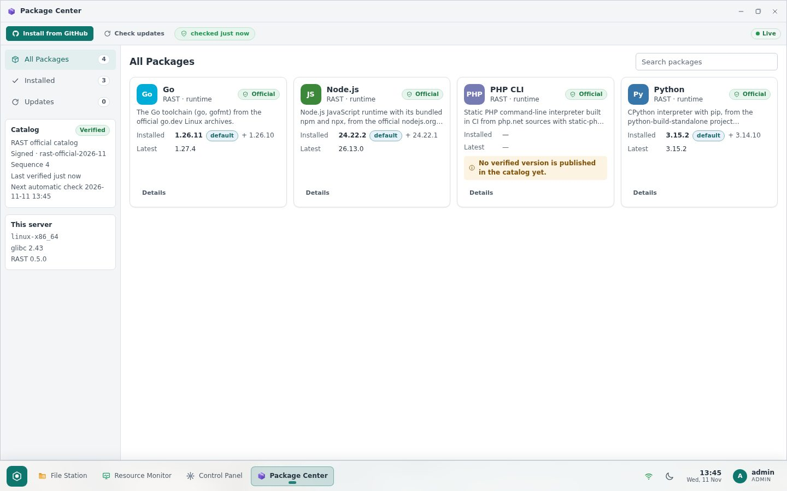

## Repositories

| Repository | Responsibility | State |
| --- | --- | --- |
| [Enricko/rast](https://github.com/Enricko/rast) | Package Center UI and API, manifest validation, signature/anti-rollback checks, downloads, safe extraction, staged installs, activation, authorization, jobs, audit | Commits listed under [Commits](#commits) |
| [Enricko/rast-packages](https://github.com/Enricko/rast-packages) | Official catalog: package definitions for Python, PHP CLI, Go and Node.js; discovery, verification, PHP builds, signing and publishing (GitHub Actions) | **Not created.** Creating the public repository was refused by this session's safety policy ("create public surface"); prepared locally with three commits |
| [Enricko/rast-package-template](https://github.com/Enricko/rast-package-template) | Forkable starter for third-party packages (working Lua 5.4 example, schema, validator, release workflow) | **Not created** (same reason); prepared locally with one commit |

To publish them (as the account owner):

```sh
cd rast-packages && gh repo create Enricko/rast-packages --public --source . --push
gh secret set CATALOG_SIGNING_KEY --repo Enricko/rast-packages < /path/to/rast-catalog-2026-11.pem   # private key, see "Signing key"
gh workflow run catalog.yml --repo Enricko/rast-packages                                            # first catalog
cd ../rast-package-template && gh repo create Enricko/rast-package-template --public --source . --push
gh repo edit Enricko/rast-package-template --template                                               # "Use this template"
git tag v5.4.9-1 && git push origin v5.4.9-1                                                       # first template release
```

The first catalog run publishes the `catalog` release whose
`catalog.json`/`catalog.json.sig` RAST reads by default
(`https://github.com/Enricko/rast-packages/releases/download/catalog/catalog.json`).

## Using Package Center

* **All Packages / Installed / Updates** in the sidebar (a tab strip in narrow
  windows). Each card shows the installed default, the newest version and, when
  relevant, *Update ready* or *New upstream … detected*.
* **Install** on a card installs the suggested version and makes it the RAST
  default when nothing is installed. **Details** has the version picker
  (grouped by release line, with incompatible versions marked and explained),
  "Make it the RAST default", the installed versions with their paths and copy
  buttons, consumers, and the job history.
* **Make default** switches `runtimes/<id>/current` and the shims in
  `packages/bin/` atomically. The previous version stays installed; switching
  back is the rollback.
* **Remove** asks you to type the version. The default version and versions
  pinned by a consumer cannot be removed.
* **Consumers** record what uses a runtime. *Follow the default* moves with the
  default; *Pin* keeps a version and protects it from removal.
* **Check updates** fetches and verifies the catalog now. RAST also checks
  automatically (`packages_check_interval_minutes`, default 6 h). The status
  chip and the catalog card show when it last succeeded; a failed check marks
  the catalog **Stale**, shows the error, and keeps the last verified catalog.
* **New upstream version detected** means the catalog workflow found a release
  and is still verifying (or building) it — nothing to install yet.
  **Update ready to install** means a verified version supersedes the default:
  it installs *next to* the current version and becomes the default only after
  its checks pass.
* **Install from GitHub** (two steps): paste a repository or release link →
  RAST shows a preview (publisher, repository, release, version, targets, the
  verification checks) → approve the source and install. See
  [rast-package-template](#third-party-packages-template). Imports need a
  verified catalog, so RAST can keep official ids and command names official.
* Progress is live (download percentage, verification, extraction, checks) in
  every open window; other windows update without reloading.

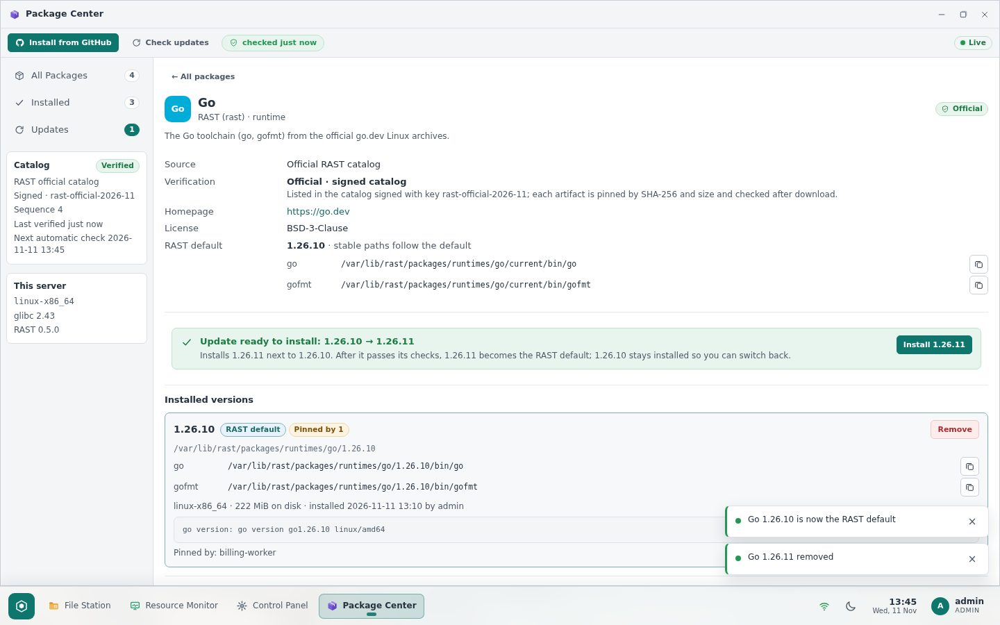

### Layout on the server

```
/var/lib/rast/packages/
  runtimes/<id>/<version>/      one directory per installed version (never overwritten in place)
  runtimes/<id>/current         symlink → the RAST default version
  bin/<executable>              shims → runtimes/<id>/current/…
  catalog/catalog.json(.sig)    last verified catalog
  .staging/  .trash/            install staging and removal (cleaned on start; a replaced
                                version waits in .trash/displaced.* until the new one is
                                recorded, and is put back if RAST stopped in between)
```

Point a service at a specific version (`…/runtimes/go/1.26.10/bin/go`) to pin
it, or at `…/runtimes/go/current/bin/go` / `…/packages/bin/go` to follow the
default. RAST never edits `/etc/profile.d`, `/usr/local/bin` or the system
`PATH`, and never touches the operating system's own Python, PHP or Node.js.
This was checked: the host's Python 3.14.4, Node v22.23.4 and PHP 8.5.4 were
unchanged after the test installs.

Under `rast.service` (`MemoryDenyWriteExecute=yes`), V8 cannot JIT. RAST runs
the Node.js checks with `NODE_OPTIONS=--jitless`. Verified in a transient
systemd unit with the same setting: plain `node` aborts, while `node --jitless`,
npm, Python (ssl, sqlite3, re) and Go run normally. Services that run Node.js
under their own units are unaffected.

## Artifact sources and verification

Nothing is rebuilt that upstream already ships. Every artifact is pinned in the
catalog by URL, size and SHA-256. RAST checks size and SHA-256 after download,
before extracting.

| Runtime | Artifact | How the catalog workflow verifies it |
| --- | --- | --- |
| Python 3.13 / 3.14 / 3.15 | `install_only` builds from [astral-sh/python-build-standalone](https://github.com/astral-sh/python-build-standalone) (glibc ≥ 2.17), with pip | SHA-256 from the release `SHA256SUMS`, equal to the GitHub asset digest; `gh attestation verify` of the upstream build provenance; extracted and run (`python3 --version`, `pip3 --version`) |
| Go 1.26 / 1.27 (two newest patches each) | `go<version>.linux-<arch>.tar.gz` from dl.google.com | SHA-256 from the go.dev release index; downloaded, re-hashed, run (`go version`) |
| Node.js 24 / 26 LTS (two newest patches each) | `node-v<version>-linux-<arch>.tar.gz` from nodejs.org | `SHASUMS256.txt` whose signature is checked with `gpgv` against the [nodejs/release-keys](https://github.com/nodejs/release-keys) keyring; run (`node --version`, `npm --version`); npm/npx (and corepack when shipped) recorded |
| PHP CLI 8.4 / 8.5 | **Built** in CI: static musl binary made with [static-php-cli](https://github.com/crazywhalecc/static-php-cli) 2.8.5 in `alpine:3.22` from the php.net source tarball | php.net source SHA-256 checked before building; static-php-cli release verified by its GitHub digest; the binary is run (`php -v`, `php -m` → extension list in the catalog); build provenance attested (`actions/attest-build-provenance`); archive published as a release asset of rast-packages and re-downloaded and compared before signing |

The catalog carries per-target artifacts for `linux-x86_64` and `linux-aarch64`
(native GitHub runners). RAST picks the artifact for its own target and checks
`requires.glibc`; versions it cannot use are shown with the reason.

## Catalog workflow (rast-packages)

`catalog.yml` runs every 6 hours and on demand:

1. **discover** — verify the published catalog (signature, sequence), query
   go.dev, nodejs.org, python-build-standalone and php.net, and keep the
   tracked release lines (`catalog.config.json`).
2. **announce** — when something is new, publish an interim catalog
   (sequence + 1) listing it under `detected` (`verifying` / `building`). RAST
   shows *New upstream version detected*. Versions already in the catalog
   remain installable throughout (also when they are only being re-verified).
3. **verify** (per target) and **php** (per version × target) — as in the
   table above.
4. **publish** — assemble the final catalog (sequence + 2), validate it with
   the same rules as RAST (`scripts/rastpkg.py` is a port of RAST's validator),
   sign it (Ed25519, key id `rast-official-2026-11`) and upload. Verified
   versions become *Update ready to install*; failures stay visible as
   `detected` / `failed` with the reason.

The catalog expires after 30 days (it is re-signed 10 days before), so a server
can tell a stale mirror from a current one. RAST refuses a catalog whose
sequence is lower than the last one it accepted (rollback), the same sequence
with different contents, a bad signature or an unknown key.

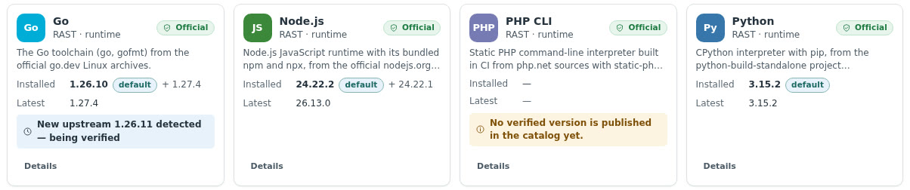

### Signing key

The catalog key pair was generated locally. The **public** key is in
`rast-packages/keys/rast-official-2026-11.pub.pem` and built into RAST
(`src/packages/catalog.rs`, `OFFICIAL_KEYS`). The **private** key is in no
repository: it goes only into the `CATALOG_SIGNING_KEY` repository secret, and
an offline backup should be kept. To rotate: add the new public key to RAST,
release, wait until servers run that release, then switch the secret.

## Third-party packages (template)

`rast-package-template` builds Lua 5.4.9 as static binaries from the lua.org
source tarball (SHA-256 checked) for both targets, writes `rast-package.json`,
attests the build and publishes a release when a tag `v<version>-<revision>` is
pushed. Install from GitHub then:

* resolves the link to one release and reads its `rast-package.json`;
* refuses artifacts that are not assets of that release, or whose size or
  SHA-256 differs from GitHub's digest for the asset; downloads may only
  redirect within GitHub's release hosts;
* pins the install to the inspected release and digests (preview valid 30 min);
* binds the package id to one repository and publisher on first approval. This
  is checked again when the install starts (under the package lock) and in the
  same database transaction that records it, so a stale preview cannot take an
  id over;
* never lets a third-party package take an official package id or provide an
  official command name (`python3`, `node`, `go`, …). Imports therefore need a
  verified catalog, so RAST can tell which ids and names are official;
* validates the manifest by exactly the rules of official packages.

Installing a third-party package means running its author's code on the
server. Its version checks run during the install as the `rast` user, inside the
sandbox described below. Landlock is mandatory for imports, so a kernel without
it cannot import packages; official packages still install. Once installed,
whatever uses the runtime runs it without RAST's sandbox. The preview dialog
says so before the source is approved.

**Check sandbox** (`src/packages/sandbox.rs`, used for every package):

* its own process group, killed on timeout and again after the check exits;
  `setsid`/`setpgid` are denied, so nothing can leave the group;
* seccomp denies `socket` (no network, no connection to the worker socket or
  any local service), io_uring, `ptrace` and `process_vm_*`, and only the
  native syscall ABI is allowed;
* Landlock allows read/execute only in the package directory and the system
  binary/library directories, read access to a few loader/name-service/TLS
  files under `/etc` and to basic `/dev` nodes, and writes only in a scratch
  home. TCP bind/connect, abstract Unix sockets and signals outside the
  sandbox are denied where the kernel supports it (Landlock ABI ≥ 4 / ≥ 6);
* no core dumps, a 64 MiB file size limit, and output written to files, not
  pipes, so a lingering child cannot stall the job.

The manifest format is [`rast-package.schema.json`](rast-package.schema.json)
(schema version 1, type `runtime`; `app` and `service` are reserved).

## Verification

Everything ran on a scratch RAST 0.5.0 instance on this server (loopback port,
own data directory, fictional accounts `admin` and `dina`). Production was not
touched. The release binary was rebuilt after every fix and the checks were
re-run.

**Target tested:** linux-x86_64, glibc 2.43, kernel 7.0 (Ubuntu 26.04).
linux-aarch64 and PHP have **not** been exercised end to end (see
[Limitations](#limitations)).

**Real catalog runs:** `catalog.py discover/verify/assemble/sign` against the
real upstreams produced two catalogs signed with the official key:

* sequence 2: Python 3.15.2 / 3.14.10 / 3.13.18 (pip 26.3); Go 1.27.4,
  1.27.3, 1.26.10, 1.26.9; Node.js 26.13.0 (npm 11.20.0), 24.22.2 and 24.22.1
  (npm 11.19.1). Go 1.26.11 was withheld on purpose.
* sequences 3 and 4: the interim catalog announcing Go 1.26.11 as
  `verifying`, then the final one publishing it.

The local `gh` has no `attestation` command, so the Python attestation step was
stubbed for these local runs. It runs for real in CI.

| Area | What was checked | Result |
| --- | --- | --- |
| Installs via the UI | Python 3.15.2, Go 1.26.10 + 1.27.4, Node.js 24.22.1 → 24.22.2, Python 3.14.10, Node.js 26.13.0 (real downloads, 55–80 MB each, 7–11 s); live progress on cards and details (`Downloading 23.1 MB of 79.4 MB · 29%` …) | Pass |
| Runtimes work | From the version directory and through the shims: `python3 --version`, `pip3 --version`, `import ssl, sqlite3, venv`; `go version` and compiling/running a program; `node --version`, `npm --version`, a `node -e` crypto script | Pass |
| Side by side, default, rollback | Two Go and two Node.js versions together; Make default and back (shim + `current` follow); update keeps the previous version | Pass |
| Live detection | Interim catalog → open window shows *New upstream 1.26.11 detected — being verified* (no install button); final catalog → *Update ready 1.26.10 → 1.26.11*; update; rollback; roll forward | Pass |
| Live push | Another session's check reached the open window in 294 ms; a default switch made elsewhere in ~330 ms; the automatic interval check in 43 s (1-minute interval) | Pass (after a fix, see below) |
| Consumers and removal | Pinned consumer keeps 1.26.10 when the default moves; typed confirmation; default and pinned versions refused (UI and API 409); removal without `confirm` refused (400) | Pass |
| Unverifiable artifact | Catalog entry with a wrong SHA-256: update fails (`SHA-256 mismatch`), toast and job history explain, default and shim unchanged, nothing left in staging | Pass |
| Incompatible versions | Needs RAST 99.0 → "unavailable" with the reason, Install disabled, API 400; aarch64-only build → "No build for this server (linux-x86_64)"; future manifest schema → listed under "versions this RAST cannot use" | Pass |
| Catalog attacks | Official, validly signed **older** catalog (seq 3 after 4) refused as rollback; tampered catalog refused (signature); untrusted key refused; catalog marked Stale with the error; installs keep working from the last verified catalog; a valid catalog clears the error | Pass |
| Sandboxed checks | Real Go, Node.js and Python checks in the sandbox on a server running with `rast.service`'s hardening; the template's Lua checks with Landlock mandatory; a hostile check could not read the database, write to the data directory or connect over TCP (see [Security review](#security-review)) | Pass |
| Install from GitHub | Non-GitHub link, release without `rast-package.json` (Enricko/rast v0.4.1), missing repository, missing tag, install without a valid inspection — all refused with a clear message | Pass |
| Template import | GitHub's API base is fixed, so the template could not be imported until its repository exists. Rehearsed instead: the template's real release output (manifest + locally built Lua archive) ran through RAST's own `manifest::parse`, `github::cross_check`, host compatibility, `install_version` and `activate`. All checks passed and `lua -e` ran through the shim. A modified archive, an asset of another release, a manifest digest mismatch, an unsafe executable path and a wrong SHA-256 at install were all refused | Pass (rehearsal) |
| Permissions | Non-admin without a grant: not in the start menu, opening refused, API 403. Group `allow`: read-only (banner, no install/default/remove/consumer/import controls; every mutating endpoint 403). Removing the group closes access in the open window in 0.4 s. Package events reach only accounts allowed to open Package Center | Pass |
| Themes and sizes | Light and dark; window 1440 (maximized), 1024, 760, 480 px; phone viewport 390 px; no horizontal overflow, nothing outside the window, dialog fits | Pass |
| Audit | `package.install/update/activate/remove/consumer_create/catalog_check` with actor and result (`source_approve` needs a real GitHub import) | Pass |
| Host untouched | OS Python/Node/PHP versions, `/usr/local/bin`, `/etc/profile.d` unchanged | Pass |

Some checks failed on the first run, and each one was resolved:

* **Bug, fixed:** the browser ignored `package.changed` and `package.catalog`,
  because named SSE events are only delivered for kinds listed in
  `frontend/src/core/sse.ts`. Open windows only caught up through their
  60-second fallback refresh, which is why the first detection took 59 s. The
  kinds were added, and `tests/event_kinds.rs` now fails whenever the server
  publishes a kind the browser does not subscribe to.
* **Bug, fixed (rast-packages):** a version being re-verified disappeared from
  the interim catalog and could be dropped by a failed re-verification.
* **Bug, fixed (rast-packages):** local runs wrote a non-existent workflow run
  URL into the provenance.
* **Polish, fixed:** jobs were labelled by the endpoint used, so a side-by-side
  install of a new major showed as "Update to 26.13.0". The server now labels
  `install`/`update`/`reinstall` by what happens. Finished jobs show
  "Installed and verified …" instead of the last phase. The global toast said
  "Package.update finished". Relative times said "0 min ago" (shared helper).
  Narrow windows cut executable paths to an identical prefix; the name now
  stays visible and the path wraps.
* **Test mistakes, corrected:** wrong expectations or selectors in the
  verification scripts — an installed newer version is offered as *Make
  default*, not reinstalled; a version needing a newer RAST stays in the picker
  as "unavailable" rather than in the unusable list. One theme check measured a
  transparent element; the screenshots show the themes.

### Security review

An independent review of the download, extraction, signature, authorization
and install code found eight issues before anything was committed. All were
fixed and tested:

| # | Finding | Fix |
| --- | --- | --- |
| 1 (high) | Version checks ran package executables (third-party code for imports) as the `rast` user with only a cleared environment; a module comment wrongly said packages never run code | The check sandbox above; Landlock mandatory for imports; the preview states that imports run third-party code; the comment was corrected |
| 2 (medium) | A child left running by a check could hold the output pipes open and block the job forever; only the direct child was killed on timeout | Output goes to files; the whole process group is killed on timeout and after exit, and cannot be left |
| 3 (medium) | The repository, publisher and official-id checks ran only when previewing. A stale preview could take over an installed id or replace an official version directory. The official-id check was skipped when no catalog was loaded, and the database never updated the owner | Re-checked at install time under the package lock and in the `record_install` transaction; imports refused without a verified catalog; approval recorded only once the install is queued |
| 4 (medium) | GNU long-name and PAX extension records were read fully into memory (no size limit); extraction could fill the disk below the 8 GiB cap | Header-only pre-scan refuses extension records over 64 KiB; downloads and extraction must leave 512 MiB free |
| 5 (low) | Reinstalling a version moved the recorded tree into `.trash`, which was emptied on restart, so a crash mid-reinstall could lose it | The old tree stays in `.trash/displaced.*` until the database records the new one; on start, RAST keeps whichever tree the database describes |
| 6 (low) | Make default switched `current` before the shims; a shim failure left `current` and the database disagreeing | `current` and any new shims are rolled back on failure |
| 7 (low) | Catalog expiry was not enforced for installs, and the on-disk cache was not compared with the anti-rollback floor | Expired catalogs drive no installs and are refused on check; a cached catalog older than the accepted sequence is ignored at start |
| 8 (low) | A third-party package could claim official command names for its shims | Refused at install time |

How the fixes were verified:

* Unit tests reproduce each case. A check script tried to read `rast.db`,
  write into the data directory and connect to a local TCP listener. Run
  outside the sandbox it did all three; installed as an import it did none.
  Other tests: a background child cannot hold the job; a hanging check is
  killed with its children; `socket`, `setsid` and `setpgid` are denied (with
  an unconfined control); oversized `L`/`K`/`x` records; the disk-space limit;
  activation rollback; restart recovery, including a forged marker; id
  ownership by source, repository and publisher.
* End-to-end tests cover the install-time re-check (official id, official
  command name, no catalog, and no approval recorded on refusal), and an
  expired catalog that blocks installs and is refused on the next check.
* The sandbox and install tests and the template import (Lua, with Landlock
  mandatory) passed inside a transient systemd unit with `rast.service`'s
  hardening (`NoNewPrivileges`, `MemoryDenyWriteExecute`, the system-call
  filter, `RestrictNamespaces`, `RestrictAddressFamilies`, …).
* The scratch server then ran under the same hardening. Go 1.27.4, Node.js
  24.22.1 and Python 3.14.10 were removed and reinstalled through the API, and
  all their checks passed in the sandbox (`go version`; `node --version` /
  `npm --version` with `--jitless`; `python3 --version` / `pip3 --version`).

Screenshots taken on the scratch instance show its data directory as the
default `/var/lib/rast`.

| | |
| --- | --- |
| 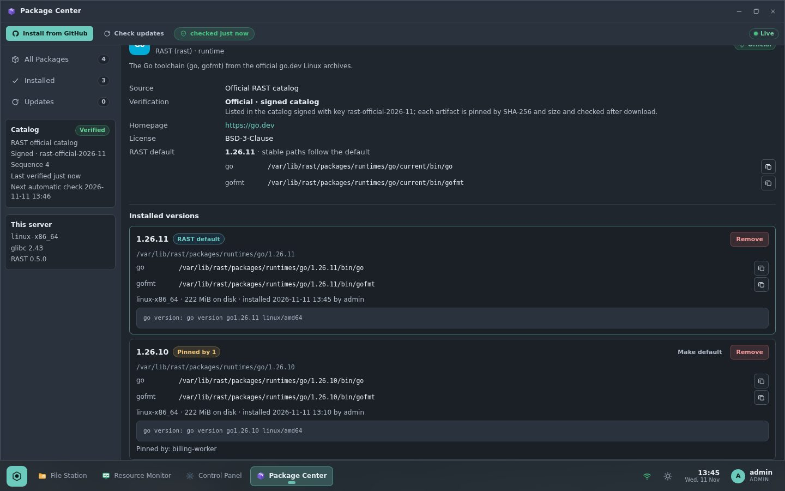 | 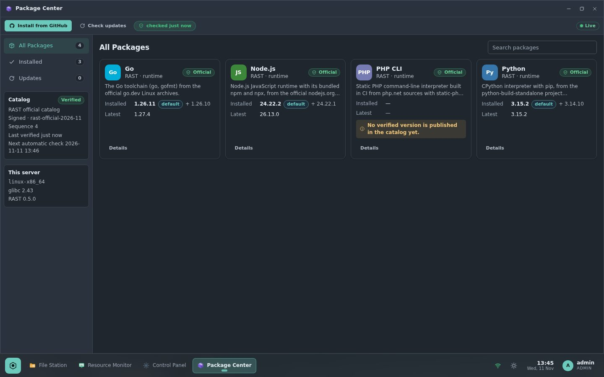 |
| 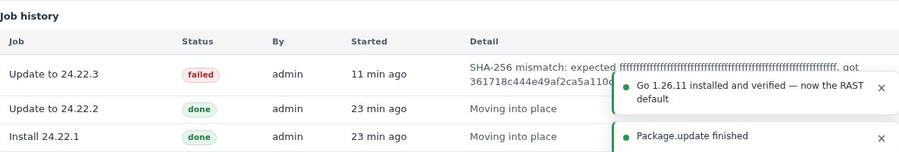 | 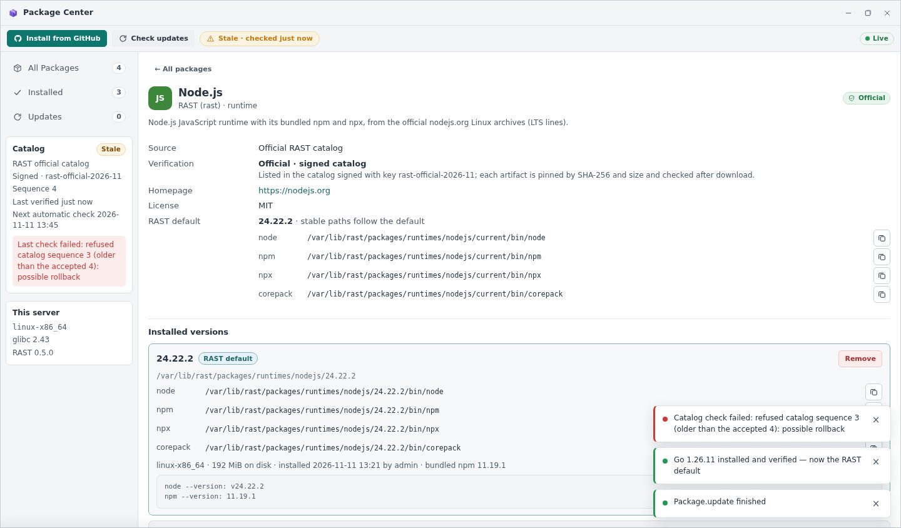 |
| 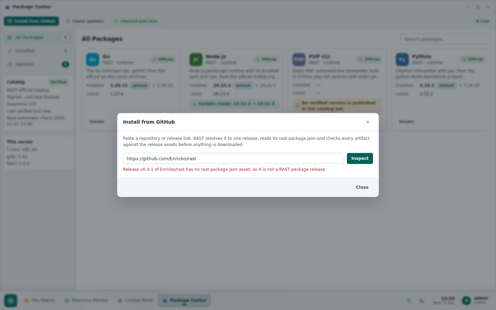 | 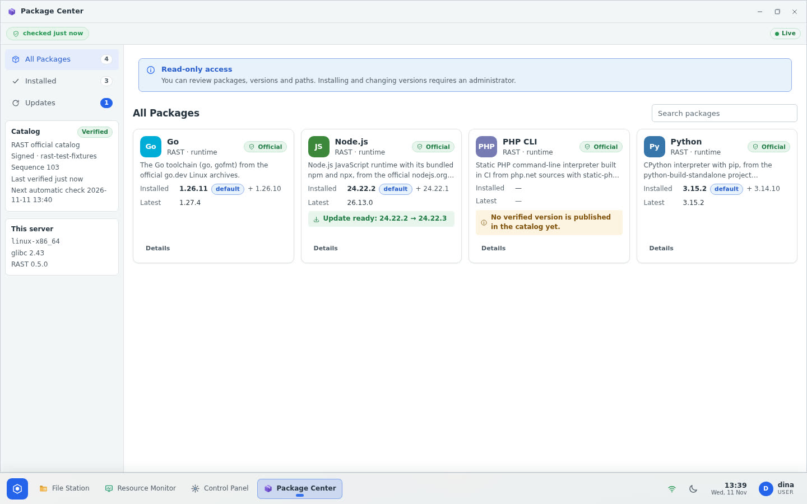 |
| 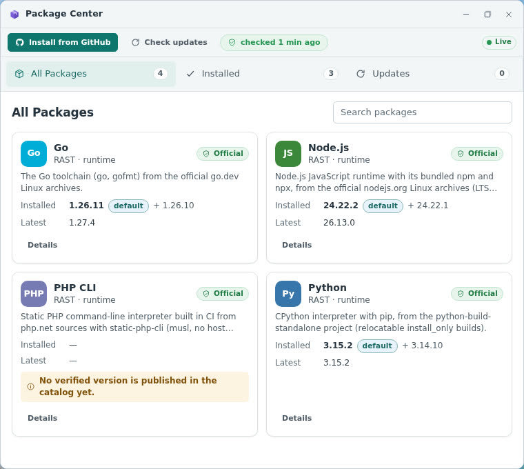 | 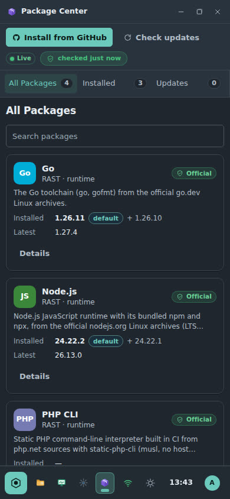 |

### Automated tests

| Suite | Result |
| --- | --- |
| `cargo test` (lib, including the sandbox, archive limits, activation rollback, restart recovery and ownership tests) | 341 passed |
| `cargo test --test api_e2e` | 31 passed |
| `cargo test --test packages_e2e` (signed `file://` catalog, rollback and tamper refusal, expiry, install-time ownership re-check, permissions, default switch, protected removal, audit) | 4 passed |
| Sandbox and install tests inside a transient unit with `rast.service`'s hardening | 10 passed |
| `cargo test --test event_kinds` | 2 passed |
| `cargo clippy --all-targets -- -D warnings` | clean |
| Frontend `npm test` / `tsc --noEmit` | 31 passed / clean |
| rast-packages `python3 -m unittest` | 8 passed |
| rast-package-template `python3 -m unittest` + local build/smoke/validate | 3 passed; Lua 5.4.9 x86_64 build OK |

## Commits

RAST (`main`):

* `404faf3` feat(packages): verified runtimes side by side from a signed catalog
* `b1a5cb1` feat(desktop): Package Center application
* `aa4539c` fix(format): never show "0 min ago"
* `4dda58d` docs: document Package Center
* `c25bc96` chore(release): prepare v0.5.0 (version 0.5.0 and changelog; **not tagged**)
* `652bf21` test(packages): keep the fictional test password out of JSON literals
* the commit that records this list

rast-packages (pushed): `5966ffb` signed catalog with discover/verify/build/publish workflow · `acc67dc` optional executables only when shipped · `8194487` keep re-verified versions installable · `ec0af98` no invented workflow run URL · `245ea13` authenticated static-php-cli downloads · `5cc1369` collect the upstream verify results.

rast-package-template (pushed): `ce85da7` forkable template with a static Lua example.

## Push and deploy status

* RAST: pushed to `main` (`ce5b6ad..c25bc96`, then `652bf21` and this commit).
  CI for `c25bc96` was green except the secrets scan, where gitleaks flagged
  the fictional e2e test password (false positive, fixed in `652bf21`; `cargo
  audit`, skipped by that failure, passes locally).
* rast-packages, rast-package-template: created by the user and pushed on
  2026-11-12.
* Deploy: **done on 2026-11-11.** Annotated tag `v0.5.0` on `13cdc23` (CI
  green); the release workflow published both binaries, `SHA256SUMS` and the
  installer. Steps:
  * backup `rast-20261111-235556-db-config.tar.gz`;
  * `sudo rast update --version 0.5.0` (with its own backup
    `rast-20261111-235843-db-config.tar.gz` and rollback binary
    `/usr/local/bin/rast.rollback-0.4.1`), which reported `health: ok` and
    schema 8 without the old schema-report error.

  Verified afterwards:
  * `rast 0.5.0`; `rast doctor`: ok, schema v8, 0 warnings;
    `rast.service` and `rast-worker.service` active;
  * `/healthz` 200 on loopback and on https://desktop.lufria.tech;
  * the served `index-CE-URyzn.js` is identical to the local build of the
    tagged commit and contains Package Center;
  * `/api/packages` answers 401 without a session;
  * the journal is clean;
  * `/var/lib/rast/packages/` was created (0750 rast:rast), with an empty
    `catalog/` because no catalog is published yet.

  The sandbox and install tests (11, including the hostile check) passed as
  the `rast` user in a transient unit with every hardening property of the
  installed `rast.service`.

  **Still to verify** once the catalog exists: catalog verified, install one
  runtime, Make default, live progress.

### After the deploy (2026-11-12)

The user created both repositories and the `CATALOG_SIGNING_KEY` secret, then
ran the catalog workflow. Three problems showed up; all are fixed:

* **Prod stayed on "catalog.json was not found (404)".** RAST's first check ran
  before the catalog existed, and 0.5.0 only checks again after the full
  interval (6 hours), silently. Restarting `rast.service` loaded the catalog
  (00:14:59 UTC). Fix on `main`, **not released yet**: `b473666`
  fix(packages): retry a failed catalog check sooner. It logs each failure and
  retries after 5, 10, 20, 40… minutes, capped at the interval. It was checked
  on a scratch instance against a missing catalog (`WARN package catalog check
  failed … failures=1 retry_in_minutes=5`). On 0.5.0, **Check updates** in
  Package Center fetches the catalog immediately.
* **The PHP 8.4.27 x86_64 build failed.** static-php-cli made anonymous
  GitHub API calls and hit the rate limit (403). rast-packages `245ea13` passes
  the job's read-only token and retries downloads.
* **Python, Go and Node.js never became installable.** Their verify jobs
  passed, but the publish job did not find the results. upload-artifact drops
  the common directory of a single-path upload, so the files were not under
  `results/`. Every one of those versions was published as "no result". Only
  PHP got in, because it uploads `dist/` and `results/`. rast-packages
  `5cc1369` matches both layouts, and fails the publish if verify succeeded
  but no results were collected. The step was replayed locally against both
  layouts.

Catalog run `43126964365` (on `5cc1369`) verified every Python, Go and Node.js
version on native x86_64 and aarch64 runners. It published **sequence 6** with
13 installable versions (Python 3.15.2/3.14.10/3.13.18, PHP 8.5.12/8.4.27, Go
1.27.4/1.27.3/1.26.11/1.26.10, Node.js 26.13.1/26.13.0/24.22.3/24.22.2) and
nothing pending. RAST's own fetch code accepts it with the built-in key.

The same path prod takes was exercised on a fresh scratch instance that uses
the official catalog URL and only the built-in key. The run covered:

* Check updates: verified, sequence 6, not stale;
* installed PHP CLI 8.4.27 (the CI build) as the default in 1.8 s, and Python
  3.14.10 in 9.7 s;
* Make default for Python published the `python3`, `python3.14` and `pip3`
  shims without conflicts;
* 33 `job.progress` events arrived over SSE;
* the shims ran `PHP 8.4.27 (cli)`, `Python 3.14.10` and `pip 26.3`.

Prod still holds sequence 1 from 00:14:59 until its next check (about 06:15
UTC) or until **Check updates** is clicked.

## Limitations

* Only **linux-x86_64** was verified. The aarch64 artifacts are produced and
  verified by the catalog workflow on native runners, which has not run yet.
* **PHP CLI** builds have not run (they need the rast-packages CI). Until then
  the catalog has no PHP version, and Package Center says so on the card.
* The **template import** was rehearsed against RAST's import code, not
  through GitHub. Run it for real after the first template release.
* Until rast-packages is published, servers on 0.5.0 show the catalog as not
  verified. That is harmless, but release 0.5.0 only after the first catalog
  exists.
* The catalog and its signature are two release assets; a check in the moment
  between their uploads can be refused once ("signature does not verify"). The
  next check succeeds, and the last verified catalog stays in use meanwhile.
* Commands run *by RAST* under `rast.service` cannot JIT (Node.js checks use
  `--jitless`); runtimes used by other services are unaffected.
* Runtimes only (schema `type: runtime`). Apps and services are reserved in the
  schema for later versions.
* The sandbox confines the **checks**, not later use: a service that runs an
  installed runtime runs it with that service's own permissions. Treat a
  third-party package like any other software you install from its author.
* Checks are limited to 60 s each. CPU, memory and process count fall under
  `rast.service`'s cgroup limits; nothing tighter is set per check.
* A source that replays the current (unexpired) catalog unchanged looks like
  "no change": *last checked* advances. A frozen mirror is caught by the 30-day
  expiry, after which installs stop and the catalog shows as expired.
* Importing needs Landlock (Ubuntu, Debian and RHEL kernels enable it) and a
  verified catalog.
