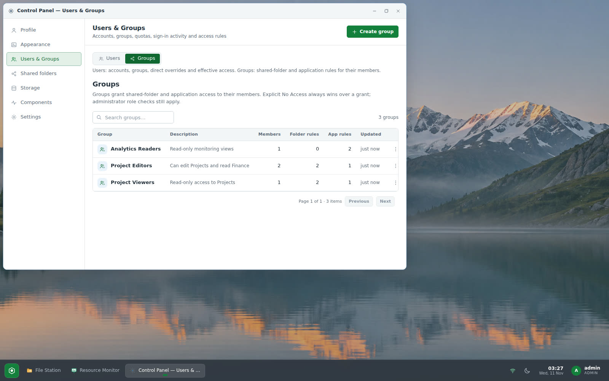
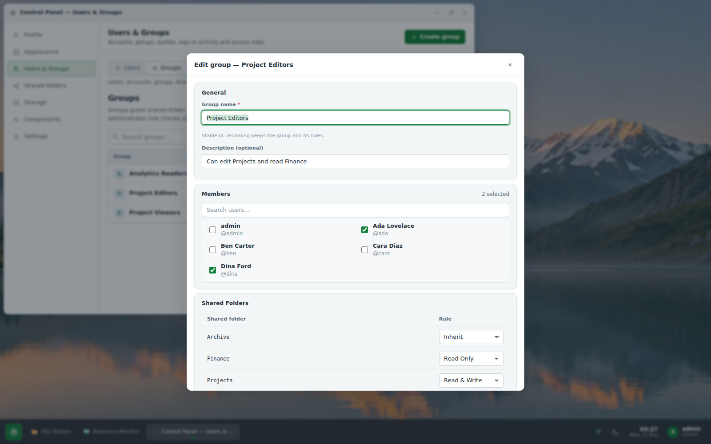
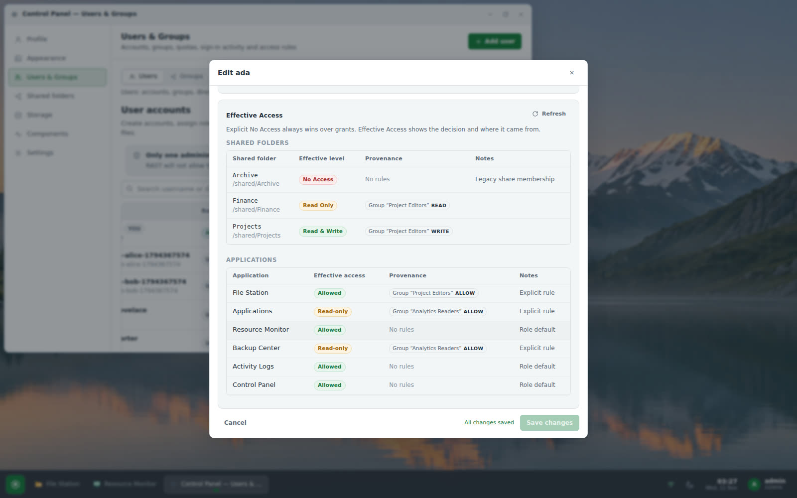
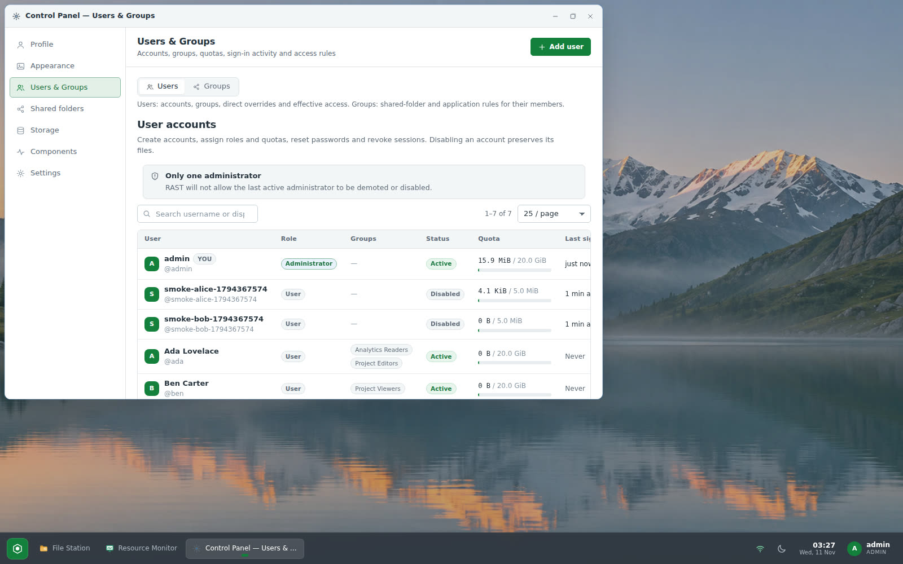
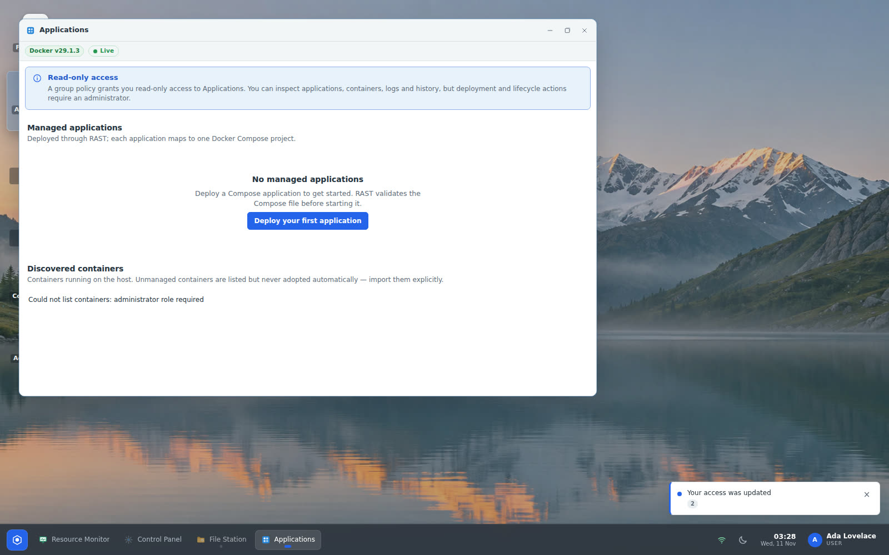
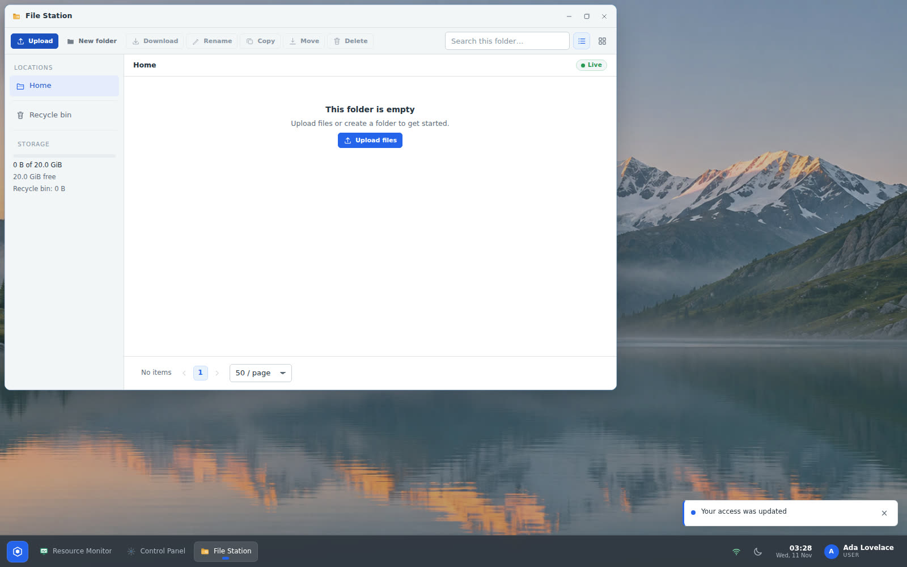

# Users & Groups — implementation handoff

RAST 0.2.0 adds NAS-style **user groups** and an enforced access policy for
shared folders and applications. This document describes what shipped, how an
administrator uses it, the permission rules and their exact precedence, the
database/upgrade story, verification evidence and the release/deployment state.

Everything below uses fictional accounts, groups and folders (`Ada Lovelace`,
`ada`, `Ben Carter`, `Project Editors`, `Projects`, `Finance`, …). No real
customer data is used in the tests, screenshots or documentation.

## 1. What was implemented

### Control Panel → Users & Groups

`Control Panel → Users & Groups` replaces the old Users tab. It has two inner
tabs:

**Users**
- Searchable, paginated list of accounts with role, status, quota, last sign-in
  and **group membership chips**.
- Account editor keeps the existing role/quota/password/session controls and
  adds:
  - **Group Membership** — a multi-select checklist; one account can belong to
    many groups.
  - **Direct Overrides** — per-account explicit rules for each shared folder
    (`Inherit`, `No Access`, `Read Only`, `Read & Write`) and application
    (`Inherit`, `No Access`, `Allow`). These are the "direct" rules used for
    exceptions and conflict handling.
  - **Effective Access** — the evaluation result per resource: final level
    (`No Access` / `Read` / `Write` / `Admin`), **provenance** (direct rule or
    the exact group that produced it), fallback label and a conflict note when
    an explicit No Access overrides a grant.

**Groups**
- Searchable, paginated group list with name, description, member count,
  shared-folder rule count, application rule count and last update.
- **Create group** and **Edit group** share one modal with four sections:
  **General** (name, description; ids are stable so renaming keeps every
  assignment), **Members** (searchable multi-select), **Shared Folders**
  (one rule per share from the live shared-folder list) and **Applications**
  (fixed catalog: File Station, Applications, Resource Monitor, Backup Center,
  Activity Logs, Control Panel). All edits are committed by **one Save
  action** with the standard RAST dirty/saving/saved/error states.
- Delete confirmation first fetches the group and reports exactly how many
  users and rules are affected, warns that users lose the access the group
  granted, and states that **users, shared folders and files are retained**.
  The typed-name confirmation must match the group name.

### Enforcement

One evaluator (`src/access/mod.rs`) is the single source of truth for:

- File Station API/storage decisions: listings, root discovery, search,
  previews, downloads, uploads (streamed and chunked), rename, copy/move
  (copy needs read on the source and write on the destination; move needs
  write on both), delete, recycle-bin restore/purge/empty.
- Background copy/move/delete jobs: permissions are re-checked when the job
  starts, so a queued job fails cleanly (no partial mutation) if access was
  revoked or the account was disabled in the meantime.
- Application surfaces: a denied application blocks its API prefix with `403`
  and its live events; a read-only grant for Applications/Backup allows only
  `GET/HEAD/OPTIONS` (lists, details, logs, history, downloads), while every
  mutation, deployment, Docker administration, backup creation/verification
  and system configuration keeps its existing administrator check.
- Live SSE subscriptions: events are filtered by the account's current
  application access, and `access.changed` is always delivered so sessions
  reauthorize immediately.
- The launcher (`/api/auth/me.permissions`), so icons, start menu, pinned apps
  and window-opens match what the backend will allow.
- The admin **Effective Access** view, so the explanation always matches the
  decision the backend actually makes.

### Live updates

Saving a group or changing a user's memberships/rules publishes:

| Event | Audience | Purpose |
| --- | --- | --- |
| `group.changed` | administrators | group list/editor refresh (dirty editors show a conflict banner instead of losing the draft) |
| `access.changed` | affected account(s) | sessions refetch `/api/auth/me`, update the launcher in place, revalidate an open File Station, clear/close revoked app windows, toast "Your access was updated" |

Share rename/delete and membership changes also publish `access.changed` to the
affected accounts. Client enforcement adds a second layer: File Station clears
stale listings and shows a friendly "Your access to this folder was changed"
message on 403/404, applications/backup clear or switch to read-only and recover
on regrant.

### Audit trail

Every management action writes an audit row (visible in Activity Logs):
`group.create`, `group.update`, `group.members_update`,
`group.permissions_update`, `group.delete`, `user.groups_update`,
`user.access_update`. Rows record the actor, group/resource, a compact
description of the change and the outcome.

## 2. Admin walkthrough (fictional example)

1. **Create the shared folders.** Control Panel → Shared folders → create
   `Projects`, `Finance` and `Archive`. New folders have no grants, so only
   administrators can see them until access is granted (explicit grant rule).
2. **Create the groups.** Control Panel → Users & Groups → Groups →
   **Create group**:
   - `Project Editors` — Members: *Ada Lovelace*, *Dina Ford*.
   - `Project Viewers` — Members: *Ben Carter*.
   - `Analytics Readers` — Members: *Ada Lovelace*.
3. **Grant folder access.** Edit `Project Editors` → Shared Folders:
   `Projects = Read & Write`, `Finance = Read Only`. Edit `Project Viewers`:
   `Projects = Read Only`, `Finance = No Access`. Save once.
4. **Grant application access.** Edit `Analytics Readers` → Applications:
   `Applications = Allow`, `Backup Center = Allow`. Because those surfaces are
   administrator-only by default, a group grant is **read-only**: members can
   inspect applications/containers/logs/history and list/download backups, but
   deployments, lifecycle actions, app deletion, backup creation/verification
   and schedule changes still require an administrator.
5. **Add an explicit exception if needed.** Users → edit *Dina Ford* → Direct
   Overrides → `Projects = No Access`. Dina stays in `Project Editors`, but the
   direct deny wins, so she cannot see or open `Projects`.
6. **Explain the result.** Users → edit *Ada Lovelace* → Effective Access shows
   `Projects: Write` (Group `Project Editors`), `Finance: Read` (Group
   `Project Editors`), `Applications: Allowed, read-only`
   (Group `Analytics Readers`). The Direct Overrides section can change an
   individual axis without touching group policy.
7. **Revoke / clean up.** Remove a member, change a rule or delete the group.
   Members lose the granted access on the next request and in already-open
   windows; accounts and files remain.

## 3. Permission rules and precedence

### Values

| Resource | Rules |
| --- | --- |
| Shared folder | `Inherit`, `No Access`, `Read Only`, `Read & Write` |
| Application | `Inherit`, `No Access`, `Allow` |

### Algorithm (same for every API and for the admin view)

For a shared folder as a non-administrator:

1. Collect **direct rules** for the account and **group rules** from every group
   the account belongs to.
2. If **any** rule is `No Access` → **No Access** (explicit deny always wins,
   regardless of who granted more).
3. Otherwise, take the **strongest grant**: `Read & Write` > `Read Only`.
   `Inherit` contributes nothing.
4. If no rule grants anything, fall back to the **pre-groups behaviour**:
   the share owner gets full access; otherwise the legacy `share_members` row
   (`read`/`write`/`admin`) decides; otherwise No Access. This is what keeps
   existing installations' effective access unchanged after the upgrade.
5. Administrators bypass folder policy. Personal home directories keep their
   ownership rules (the owner always has full control over their own home;
   admins too; other users never see it).

For an application as a non-administrator:

1. Any explicit `No Access` → denied.
2. Any explicit `Allow` → allowed. For `Applications` and `Backup Center`
   (administrator-only by default) the grant is **read-only**; for surfaces
   every account may already use, `Allow` is a regular grant.
3. No rule → the documented default: File Station, Resource Monitor, Activity
   Logs and the Control Panel profile/appearance are available; Applications
   and Backup Center are administrator-only.
4. Group permissions **never** grant the administrator role or unlock
   administrator endpoints. Role checks for deployment, users, settings and
   system configuration stay in force.

Hidden or denied shared folders answer `404` (not `403`) so their existence is
not leaked; a read-only account that attempts to write gets `403`.

### Worked example (fictional)

Accounts: *ada* (Project Editors, Analytics Readers), *dina* (Project Editors,
direct rule Projects=No Access), *ben* (Project Viewers), *cara* (no groups).

| Resource / rule source | ada | ben | dina | cara |
| --- | --- | --- | --- | --- |
| `Projects` — Project Editors | Read & Write | — | Read & Write | — |
| `Projects` — Project Viewers | — | Read Only | — | — |
| `Projects` — direct rule | — | — | **No Access** | — |
| **Effective `Projects`** | **Write** | **Read Only** | **No Access** | **No Access** |
| `Finance` — Project Editors | Read Only | — | Read Only | — |
| `Finance` — Project Viewers | — | **No Access** | — | — |
| **Effective `Finance`** | **Read Only** | **No Access** | **Read Only** | **No Access** |
| Applications — Analytics Readers | Allow → read-only | default denied | default denied | default denied |
| File Station | allowed | allowed | allowed | allowed |

Consequences shown in the UI and enforced by the API: Ada can upload/rename
inside `Projects` and download/read `Finance`; Ben can list/download `Projects`
and receives `403` on any write; Dina cannot see `Projects` at all even though
her group grants write; Cara sees neither folder. Removing Ada from
`Project Editors` immediately revokes her writes and clears her open File
Station listing after the `access.changed` event.

## 4. Database migration, upgrade and recovery

### Migration

New additive migration: `migrations/0004_groups.sql`.

New tables (no existing table is modified):

- `groups (id INTEGER PRIMARY KEY AUTOINCREMENT, name UNIQUE COLLATE NOCASE,
  description, created_at, updated_at)` — stable ids; renames keep assignments.
- `group_members (group_id, user_id, added_at)` with FK cascades and an index on
  `user_id`.
- `group_folder_rules (group_id, share_name COLLATE NOCASE, rule)` and
  `group_app_rules (group_id, app_id, rule)` with indexes.
- `user_folder_rules` / `user_app_rules` for direct overrides.

Shared folders are referenced by display name inside the policy tables; share
rename/delete rewrites or removes the affected rules in the same transaction as
the share change and invalidates the decision cache. Rules reference stable
application ids (`files`, `applications`, `monitor`, `backup`, `logs`,
`controlpanel`).

### Upgrade behaviour

- Applying `0004` creates tables only; users, shares, `share_members`,
  appearance data, files and audit history are untouched.
- No rules exist immediately after the upgrade, so the evaluator's legacy
  fallback returns exactly the previous effective access for every existing
  user/share membership. A migration test builds a v0.1.8 schema with a legacy
  `share_members` row, applies `0004` with the current binary's embedded
  migrator, and asserts the legacy access and appearance rows are preserved.
- Fresh installations get schema version 4 directly.

### Deployment procedure used (and rollback)

1. Stop accepting writes isn't required: SQLite WAL + the migrator run in a
   transaction on service start.
2. **Back up the database before applying the migration** (done for the
   production deployment; see section 6):
   `sudo sqlite3 /var/lib/rast/rast.db ".backup '/root/rast-db-pre-v0.2.0.sqlite'"`
   followed by `PRAGMA integrity_check;` and a size/hash record. Wallpaper
   uploads live on disk under `/var/lib/rast/wallpapers/` and are unaffected by
   this migration; include them in regular backups anyway.
3. Install the release (`install.sh`). The service restarts, applies `0004`,
   and `rast doctor` reports `schema v4`.
4. Rollback: stop `rast.service`, install the previous release binary, restore
   the backup database (`sqlite3 /var/lib/rast/rast.db < backup` or `.restore`)
   **only if** the old binary rejects the newer schema; data written after the
   backup would be lost, so prefer fixing forward. Group tables are additive, so
   the old binary can typically run on a schema-v4 database (it ignores the new
   tables); restoring the backup is the conservative path.

## 5. Verification

### Automated tests

Current tree: **284 lib tests + 22 HTTP end-to-end tests**, all passing, with
`cargo check --all-targets`, `cargo clippy --all-targets -- -D warnings` and
`cargo fmt --all -- --check` clean. Focused coverage added for this feature:

- Evaluator: direct deny vs group grant in both orders, strongest-grant merge,
  `Read & Write` including read, application defaults/allow/deny/read-only,
  legacy `share_members` fallback and owner/admin behaviour, hidden shares.
- Groups API: CRUD, stable id across rename, membership replacement, rule
  replacement, delete impact counts and retention, audit actions,
  `group.changed`/`access.changed` scopes, invalid input rejection.
- Enforcement: editor upload, viewer list/search/download, viewer write `403`,
  hidden `404` in roots/listing, copy read-source/no-write-destination and move
  write-both denials, shared-folder rule rewrite on rename/delete, job-start
  recheck after revocation, direct app denial on the API prefix, read-only app
  grants (list/download `200`, mutations `403`), SSE event filtering
  (monitor denied → no monitor events; restored → events resume), immediate
  revocation in a signed-in session.
- Migration: `0004` additive upgrade on a representative v0.1.8 database with
  legacy ACL rows and appearance settings preserved.
- Smoke suite: group grant → folder visible/readable, upload denied, effective
  access provenance, read-only Applications list + deploy denied, membership
  revocation, group delete retention; the production run reports
  **84 passed / 0 failed / 0 skipped** (Docker-enabled host).

### Browser workflows verified (real backend, headless Chromium)

44/44 Playwright checks on the running build, using fictional data:

- Control Panel tab is **Users & Groups**; inner Users/Groups segmented control;
  users table shows fictional accounts and group chips; groups table shows
  member/rule counts and search.
- Group editor shows General / Members / Shared Folders / Applications, the
  configured members/rules, and preserves members/rules through a single Save;
  a group created from the UI appears with its member and rule; delete
  confirmation reports affected users/rules and deleting keeps users.
- User editor shows Group Membership, Direct Overrides and Effective Access;
  the explanation names the group that granted write; an explicit direct No
  Access is shown as overriding the group grant.
- Viewer: group-granted folder visible in roots, listing `200`, upload `403`;
  editor: upload `200`, viewer downloads the file `200`; unrelated user: folder
  hidden from roots and `404` on direct path; direct-deny user: hidden despite a
  group write grant.
- Applications default-denied for a regular user, read-only group grant lists
  applications but deployment `403`, Backup Center read-only list works.
- Live revocation: admin removes the editor membership while the account has
  File Station open; the API immediately returns `404`, the open window clears
  the stale listing and shows the access message/state.
- Read-only Applications window shows the read-only banner and no deploy action.
- Group creation/deletion and effective access screenshots are captured from
  the live deployment (see `docs/screenshots/` and section 6).

### Remaining limitations

- Member and user pickers load the first 100 accounts (bounded query); groups
  support many members and server pagination, but the member picker UI is
  bounded for very large installations.
- Effective Access lists all shared folders (admin view) or only accessible
  ones (own view); it does not page very large share inventories.
- Renaming a share while a rule references an old name is handled by an
  in-transaction rewrite; if a same-named rule already exists under the new
  name, the old-share rule wins (`UPDATE OR REPLACE`), then the share keeps the
  rule set of the new name.
- Deactivated accounts are not offered in group member pickers; existing
  memberships are preserved on save and can be removed manually.
- Group rules apply to shared-folder and application surfaces only; per-file or
  per-subfolder policy beyond the share boundary is out of scope.
- External filesystem watcher events for shared folders reach the evaluator's
  audience (legacy members, owner, group/direct rule holders); non-member
  administrators do not receive private home/share events.
- Existing limitations of the platform remain (no release artifact signing,
  arm64 build-only, glibc+systemd only, Docker path exercised on this host).

## 6. Release status

- Branch: `main` (existing workflow; no force pushes).
- Feature commits:
  - `a85499f` — `feat(groups): add group policy schema, evaluator and management API`
  - `2a9e8e1` — `feat(access): enforce group folder and application permissions`
  - `8d9cae4` — `feat(ui): add Users & Groups management and permission-aware surfaces`
  - `7513dc7` — `docs(release): prepare v0.2.0 with Users & Groups handoff`
    (version 0.2.0, changelog, README, this handout)
- Tag / release: **v0.2.0** → tag commit `7513dc7ecfe663c57651c8291cab01ad7a2a84b4`,
  published at <https://github.com/Enricko/rast/releases/tag/v0.2.0> (6 assets:
  x86_64 + aarch64 binaries, SHA256SUMS, install.sh, uninstall.sh,
  rast.toml.example).
- Push status: all commits above pushed to `origin/main` (HEAD == origin/main).
  Release workflow run `42952430209` and CI run `42952428565` for the tag
  commit both succeeded.
- Deployment: **https://desktop.lufria.tech** runs **RAST 0.2.0**
  (`7513dc7`), schema **v4** (`1|init, 2|appearance, 3|appearance accent,
  4|groups`), `rast doctor` 0 warnings, `rast.service`/`rast-worker.service`
  active.
  - Pre-migration production backup:
    `/root/rast-db-pre-v0.2.0.sqlite`, sha256
    `d9c7e2d434ef8aa0c0f01ae99bf27a668d3d873875925eae439b7d89f3949a19`,
    integrity `ok`, 1 user, 0 shares, migrations 1–3. Post-migration row checks
    confirmed users, appearance settings and shared-folder data were preserved.
  - Live verification after deploy: **85/85 production smoke checks**
    (0 failed, 0 skipped, Docker worker included), **44/44 Playwright Users &
    Groups checks** on the live URL using fictional accounts/folders (all
    screenshots in this document and `docs/screenshots/user-groups-*.jpg` come
    from that run), and an independent clean-systemd-container installer run
    (**64 PASS / 0 FAIL / 0 SKIP**, Ubuntu 24.04 systemd container, binary
    reports `RAST 0.2.0 (7513dc7ecfe6)`).
  - Independent migration adjudication: a real **v0.1.8** database was built with
    the published v0.1.8 binary (admin + user + appearance row + legacy share +
    `share_members=write`), then upgraded with v0.2.0 — schema v4, migration
    `0004` only, all legacy rows byte-identical, groups tables empty, and the
    legacy user's effective access stayed `write` via the documented
    `legacy-acl` fallback (roots/list/create all still 200). Fresh install is
    schema v4. Release notes start with the CHANGELOG `[0.2.0]` section and this
    handout is present in the release tree.
  - Resource measurement after a clean restart (`rast.service` 11.4 MiB /
    0.13% CPU + worker 9.9 MiB / 0.03% CPU ≈ 21.4 MiB total idle).
  - Test artifacts were removed after verification: only the real `admin`
    account remains, groups/shares created by the tests were deleted, shared
    test directories and home directories of fictional users were removed, and
    the pre-existing `/srv/rast/shared/team` directory was left untouched.

### Where to look in the UI

- Control Panel → **Users & Groups** (Users tab: accounts/membership/effective
  access; Groups tab: group policy).
- Shared folders are defined in **Control Panel → Shared folders**; their
  group rules are edited inside each group.
- Activity Logs → filter by `group.` / `user.groups_update` /
  `user.access_update` actions for the audit trail.
- Launcher and window-open permissions follow `/api/auth/me.permissions`;
  revoked access closes affected windows with a clear message.
- API contract: `docs/API.md` (Users, groups and access policy section);
  internal design contract: `docs/GROUPS.md`.

### Screenshots

| | |
| --- | --- |
|  |  |
|  |  |
|  |  |

Additional captures: `docs/screenshots/user-groups-editor-applications.jpg`
(group editor Applications section) and
`docs/screenshots/user-groups-conflict.jpg` (explicit-deny conflict explanation).
